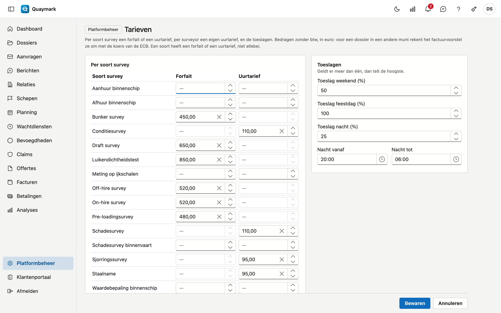

# Tarieven

De tarieven waarmee Quaymark een factuur voorstelt. Bedragen zonder btw, in euro. Voor een dossier in een andere munt rekent het voorstel ze om (zie [Facturen](facturen.md#vreemde-munten)).

## Het scherm openen

Klik onderaan het menu op **Platformbeheer** en dan op de tegel **Tarieven**. Enkel de beheerder van het bureau ziet dit scherm.

## Per soort survey

Elke soort survey krijgt een **Forfait** (een vast bedrag per dossier) óf een **Uurtarief**, niet beide: vult u het ene in, dan staat het andere op die regel uit. Laat beide leeg voor een soort die u niet volgens een vast tarief aanrekent.

## Per surveyor

Een surveyor kan een eigen **Uurtarief** hebben. Dat gaat voor op het uurtarief van de soort survey. Leeg betekent: het uurtarief van de soort.

## Toeslagen

Een toeslag in procent voor het **weekend**, een **feestdag** en de **nacht**. De nacht loopt van **Nacht vanaf** tot **Nacht tot** (standaard van 20:00 tot 06:00). Geldt er meer dan één toeslag, dan telt de hoogste; ze worden niet opgeteld.

## Raamafspraken

Een opdrachtgever met eigen afspraken krijgt zijn tarieven op de relatiefiche, tabblad Raamafspraken. Die gaan voor op deze kaart, ook op het tarief van een surveyor. → [Raamafspraken](relaties.md#raamafspraken)

## Zie ook

- [Dossiers](dossiers.md)
