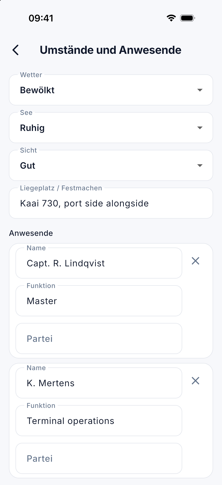
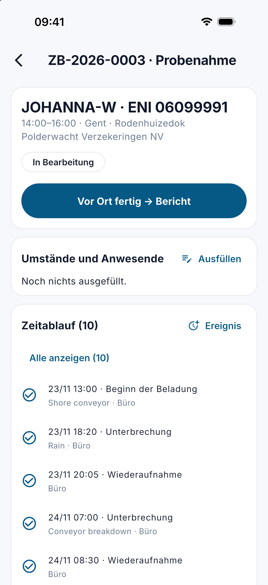
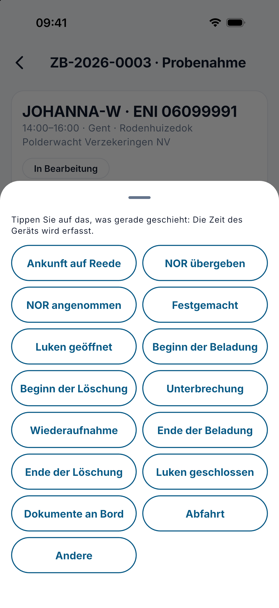
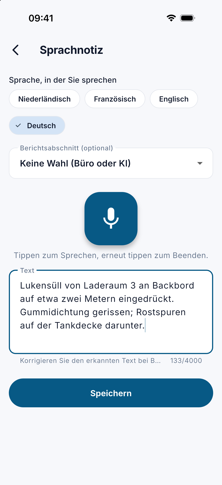
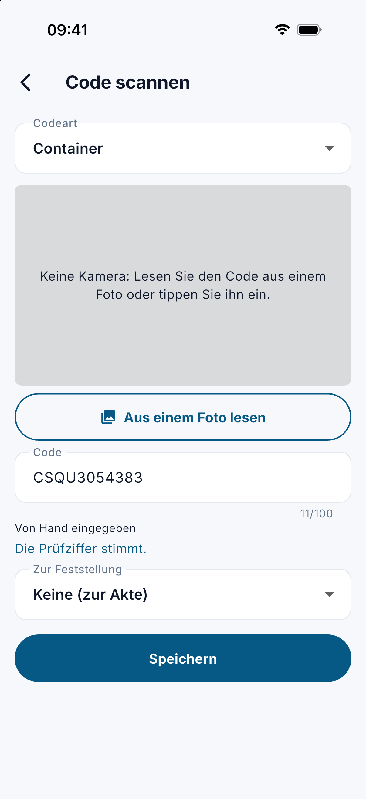
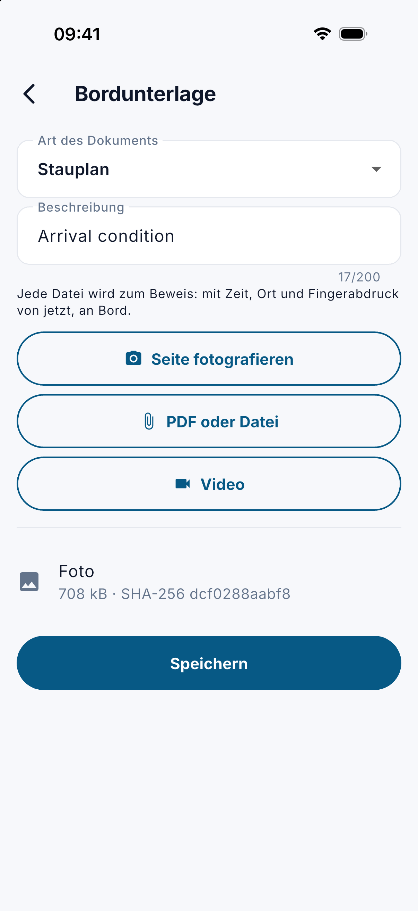

# An Bord erfassen

Neben Feststellungen erfassen Sie an Bord auch die Umstände, die Anwesenden, den Zeitablauf, Notizen, Codes, Unterlagen und Peilungen. Jedes hat seine Karte in der Akte, und alles funktioniert offline.

## Umstände und Anwesende

Auf der Karte **Umstände und Anwesende** erfassen Sie, unter welchen Umständen die Besichtigung stattfand und wer dabei war. Tippen Sie auf **Ausfüllen**.

{ width="320" }

1. Wählen Sie **Wetter**, **See** und **Sicht**. Mit **—** lassen Sie eine Auswahl leer.
2. Füllen Sie bei Bedarf **Liegeplatz / Festmachen** aus, zum Beispiel *Kaai 730, port side alongside*.
3. Tippen Sie unter **Anwesende** auf **Anwesenden hinzufügen** und füllen Sie **Name** aus, bei Bedarf auch **Funktion** und **Partei**, die die Person vertritt. Mit dem Kreuz entfernen Sie einen Anwesenden.
4. Tippen Sie auf **Speichern**.

Ein Anwesender mit einer Funktion oder einer Partei braucht auch einen Namen; sonst sagt die App *Geben Sie jedem Anwesenden einen Namen oder entfernen Sie die Zeile.* Es sind höchstens 30 Anwesende möglich. Das Büro sieht und ändert dieselben Angaben in der Akte. → [Akten](../dossiers.md#akte)

### Das Büro hat inzwischen geändert

Hat das Büro die Umstände oder die Anwesenden geändert, während Ihre Änderung noch auf dem Gerät wartete, überschreibt Quaymark nichts. Ihre Änderung steht dann rot unter **Noch zu senden**.

1. Tippen Sie auf **Bearbeiten**. Oben steht *Das Büro hat dies inzwischen geändert. So steht es jetzt im Büro:*, mit dem, was das Büro ausgefüllt hat. Darunter steht Ihre eigene Auswahl.
2. Übernehmen Sie alles vom Büro mit **Die des Büros übernehmen**, oder wählen Sie pro Feld, was dort stehen soll.
3. Tippen Sie auf **Speichern**.

Wählen Sie genau das, was das Büro schon hat, wird nichts gesendet: Es ist schon da. → [Eine abgelehnte Aktion](zonder-bereik.md#eine-abgelehnte-aktion)

## Zeitablauf

Bei einer Besichtigungsart mit Zeitablauf (dem Statement of Facts) trägt die Akte die Karte **Zeitablauf**. Darauf halten Sie fest, was mit dem Schiff geschieht: von der Ankunft bis zur Abfahrt.

{ width="320" }

{ width="320" }

1. Tippen Sie auf **Ereignis**.
2. Tippen Sie auf das, was gerade geschieht, zum Beispiel **Beginn der Beladung** oder **Unterbrechung**. Die Zeit des Geräts wird erfasst.

Die App sagt zum Beispiel *Unterbrechung erfasst.*, und das Ereignis steht sofort auf der Karte. Bei **Andere** füllen Sie eine **Beschreibung** aus und tippen auf **Speichern**.

Die Auswahl: **Ankunft auf Reede**, **NOR übergeben**, **NOR angenommen**, **Festgemacht**, **Luken geöffnet**, **Beginn der Beladung**, **Beginn der Löschung**, **Unterbrechung**, **Wiederaufnahme**, **Ende der Beladung**, **Ende der Löschung**, **Luken geschlossen**, **Dokumente an Bord**, **Abfahrt** und **Andere**.

Die Karte zeigt die letzten fünf Ereignisse; **Alle anzeigen** zeigt alle. Was das Büro ausgefüllt hat, trägt den Vermerk *Büro*, mit den Uhrzeiten, wie das Büro sie sieht: in der Zeit der Niederlassung.

In der App fügen Sie ein Ereignis nur hinzu. Einen Fehler berichtigt das Büro auf der Registerkarte **Zeitablauf**. → [Zeitablauf](../dossiers.md#zeitablauf)

## Sprachnotizen

Diktieren Sie eine Notiz, statt sie zu tippen. Tippen Sie auf **Diktieren** auf der Karte **Notizen**.

{ width="320" }

1. Wählen Sie die **Sprache, in der Sie sprechen**. Die App beginnt mit der Sprache der App.
2. Wählen Sie bei Bedarf den **Berichtsabschnitt (optional)**. Ohne Wahl (**Keine Wahl (Büro oder KI)**) wählen später das Büro oder die KI.
3. Tippen Sie auf das Mikrofon und sprechen Sie. Das Gerät schreibt sofort mit. Tippen Sie erneut, um zu beenden.
4. Korrigieren Sie den Text bei Bedarf und tippen Sie auf **Speichern**.

Nur der **Text** geht an Quaymark, mit der Uhrzeit und der Position des Beginns. Der Ton wird nicht aufbewahrt. Gibt es nach 15 Sekunden keine Position (tief im Laderaum), wird die Notiz ohne Position gesendet.

Hat das Gerät keine Spracherkennung oder darf die App sie nicht nutzen, sagt der Bildschirm das. Tippen Sie die Notiz dann oder nutzen Sie das Mikrofon der Tastatur. Im Büro stehen die Notizen beim Bericht. → [Sprachnotizen](../dossiers.md#sprachnotizen)

## Codes

Scannen Sie Containernummern, Plomben und Proben. Tippen Sie auf **Scannen** auf der Karte **Codes**.

{ width="320" }

1. Wählen Sie die **Codeart**: **Container**, **Plombe**, **Probe** oder **Anderer Code**.
2. Richten Sie die Kamera auf den Code. Oder tippen Sie auf **Aus einem Foto lesen**, um den Code aus einem Foto des Geräts zu lesen, oder tippen Sie ihn unter **Code** ein.
3. Wählen Sie unter **Zur Feststellung** die Feststellung, zu der der Code gehört, oder lassen Sie **Keine (zur Akte)** stehen.
4. Tippen Sie auf **Speichern**.

Unter dem Code steht, wie er hereinkam: **Gescannt**, mit dem Format, oder **Von Hand eingegeben**. Korrigieren Sie einen gescannten Code, wird er zu einem eingetippten Code.

Eine **Containernummer** besteht aus 4 Buchstaben, der letzte U, J oder Z, und 7 Ziffern. Die App rechnet die Prüfziffer nach und sagt **Die Prüfziffer stimmt.** oder welche Ziffer sie erwartet hat. Stimmt sie nicht, fragt die App **Trotzdem speichern?**: Der Code wird dann mit der Markierung *Prüfziffer stimmt nicht* gespeichert, und die Karte zeigt eine Warnung. → [Codes](../dossiers.md#codes)

## Bordunterlagen

Erfassen Sie den Stauplan, das Ladungsmanifest, das Logbuch, einen Lieferschein oder ein Zertifikat. Tippen Sie auf **Hinzufügen** auf der Karte **Bordunterlagen**.

{ width="320" }

1. Wählen Sie die **Art des Dokuments**: **Stauplan**, **Ladungsmanifest**, **Logbuch**, **Lieferschein**, **Zertifikat** oder **Anderes Dokument**. Geben Sie bei Bedarf eine **Beschreibung** ein.
2. Fügen Sie die Dateien hinzu:
    - **Seite fotografieren**: ein Foto pro Seite;
    - **PDF oder Datei**: ein PDF oder Foto, das schon auf dem Gerät ist;
    - **Video**: **Video aufnehmen** oder **Video wählen**.
3. Tippen Sie auf **Speichern**.

Ein Foto oder PDF darf höchstens 50 MB groß sein, ein Video höchstens 200 MB (mp4 oder mov). Jede Datei wird zum Beweis wie ein Foto: mit Uhrzeit, Ort und Fingerabdruck des Moments, in dem Sie sie hinzufügen. Die Liste zeigt die Größe und den Anfang des Fingerabdrucks. Speichern Sie nicht, löscht die App die Dateien wieder vom Gerät. → [Bordunterlagen](../dossiers.md#bordunterlagen)

## Bunkerbesichtigung

Bei einer Besichtigungsart mit Bunkerbesichtigung trägt die Akte die Karte **Bunkerbesichtigung**. Tippen Sie darauf, um die Brennstofftanks des Schiffs zu sehen.

<!-- AFBEELDING: het scherm Bunker survey met tanks (app-bunker-de) -->

1. Wählen Sie oben **Vorher** oder **Nachher** (vor oder nach dem Bunkern).
2. Tippen Sie auf einen Tank. Ein Tank, der noch nicht gepeilt ist, zeigt *noch nicht gepeilt*.
3. Geben Sie die Peilung ein: **Produkt**, **Methode** (**Peilung** oder **Leerraum**), **Gemessen (cm)**, **Korrektur Trimm/Krängung (cm)**, **Volumen aus der Tabelle (m³)**, **Temperatur (°C)** und bei Bedarf die **Dichte 15 °C (kg/m³), leer = BDN**.
4. Tippen Sie auf **Speichern**.

Volumen und Temperatur sind Pflicht. Die App zeigt eine **Schätzung** in Tonnen als Hilfe vor Ort; Quaymark rechnet selbst neu. Einen Tank, den das Schiff noch nicht hatte, fügen Sie mit **Tank hinzufügen** hinzu.

Eine Peilung beginnt mit den Werten der vorigen. Eine Korrektur ist eine neue Peilung: Die letzte pro Tank zählt. → [Bunkerbesichtigung](../dossiers.md#bunkerbesichtigung)

### Messgeräte

Unter den Peilungen steht der Block **Messgeräte**: Dort wählen Sie die Geräte, mit denen Sie gepeilt haben, etwa das Thermometer und das Peilband.

1. Tippen Sie auf **Gerät wählen**.
2. Tippen Sie auf das Gerät. Oben stehen die Geräte, die **Vorgeschlagen für Bunker** sind, darunter **Andere Geräte**. Bei jedem Gerät steht der Stand seiner Kalibrierung: **Gültig**, **Läuft bald ab**, **Abgelaufen** oder **Nie kalibriert**.

Ein Gerät mit abgelaufener Kalibrierung oder ohne Kalibrierung können Sie trotzdem wählen. Die App warnt: *Sie können normal messen: Der Bericht vermerkt es.* Ein gewähltes Gerät entfernen kann nur das Büro. → [Messgeräte](../meetapparatuur.md#bei-einer-messung)

## Siehe auch

- [Die Akte](dossier.md)
- [Offline](zonder-bereik.md)
