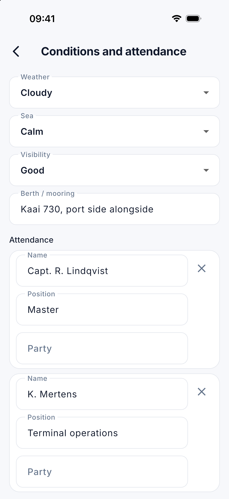
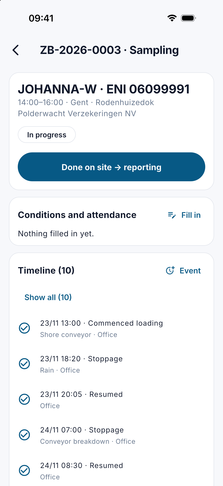
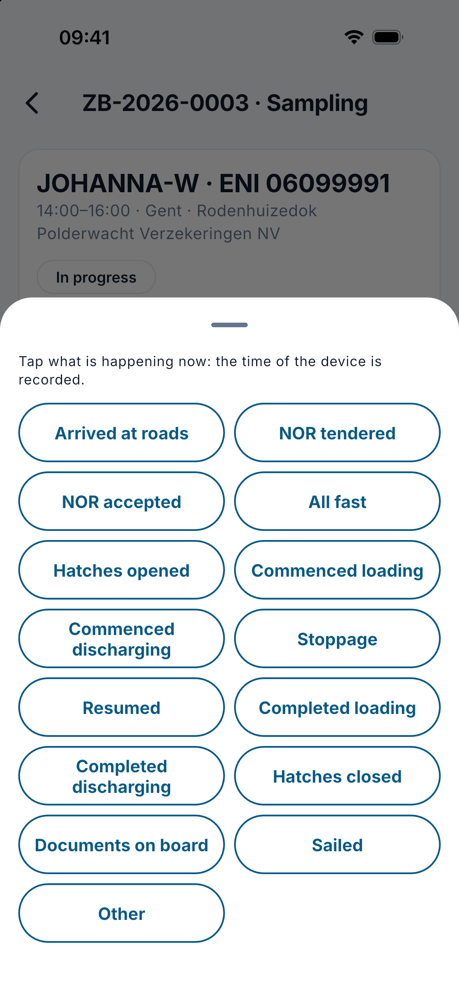
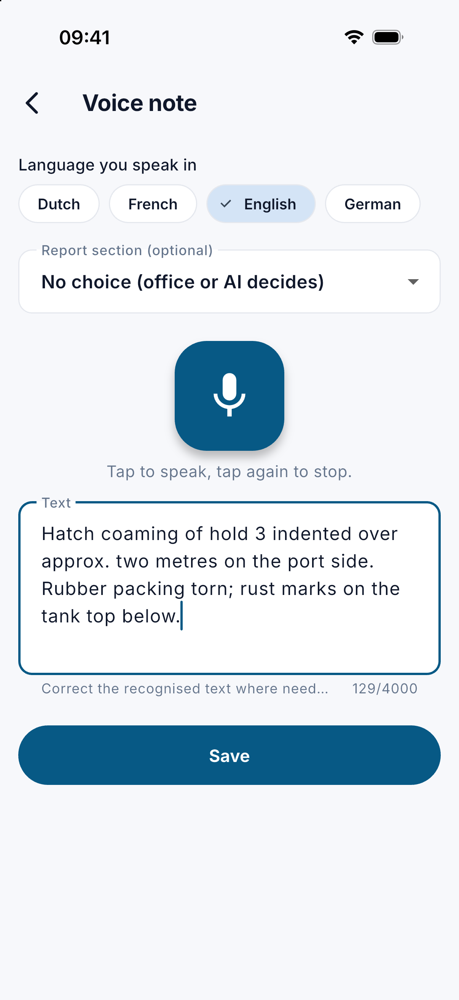
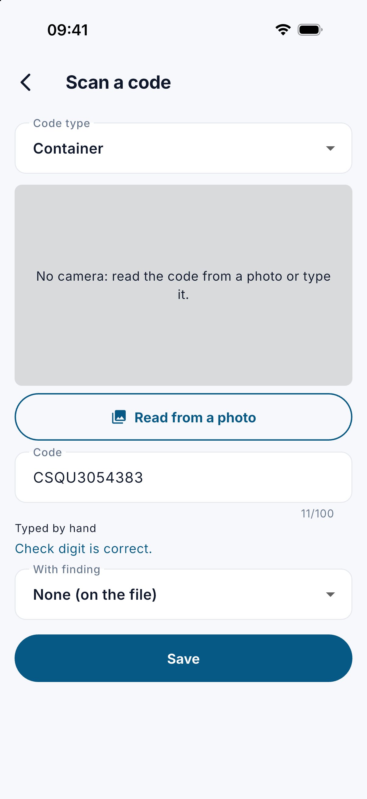
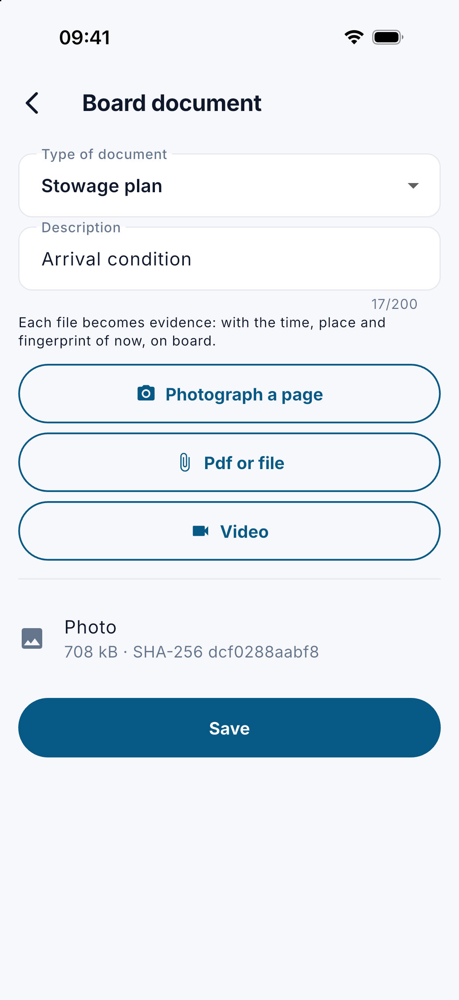

# Recording on board

Besides findings, you also record the conditions, the attendance, the timeline, notes, codes, documents and soundings on board. Each has its card on the file, and everything works offline.

## Conditions and attendance

On the **Conditions and attendance** card you record the conditions of the survey and who attended. Tap **Fill in**.

{ width="320" }

1. Choose the **Weather**, the **Sea** and the **Visibility**. With **—** you leave a choice empty.
2. Optionally fill in **Berth / mooring**, for example *Kaai 730, port side alongside*.
3. Under **Attendance**, tap **Add attendee** and fill in the **Name**, and optionally the **Position** and the **Party** the person represents. The cross removes an attendee.
4. Tap **Save**.

An attendee with a position or a party also needs a name; otherwise the app says *Give every attendee a name, or remove the row.* There can be at most 30 attendees. The office sees and changes the same details on the file. → [Files](../dossiers.md#file)

### The office changed it in the meantime

If the office changed the conditions or the attendance while your change was still waiting on the device, Quaymark overwrites nothing. Your change then shows in red on **Still to send**.

1. Tap **Edit**. At the top it says *The office changed this in the meantime. This is what the office has now:*, with what the office filled in. Your own choice is below.
2. Take over everything from the office with **Use the office's**, or choose per field what it should say.
3. Tap **Save**.

If you choose exactly what the office already has, nothing is sent: it is already there. → [A refused action](zonder-bereik.md#a-refused-action)

## Timeline

For a survey type with a timeline (the statement of facts), the file has the **Timeline** card. On it you keep track of what happens to the vessel: from arrival to departure.

{ width="320" }

{ width="320" }

1. Tap **Event**.
2. Tap what is happening now, for example **Commenced loading** or **Stoppage**. The time of the device is recorded.

The app says, for example, *Stoppage recorded.*, and the event is on the card straight away. For **Other**, fill in a **Description** and tap **Save**.

The choices are: **Arrived at roads**, **NOR tendered**, **NOR accepted**, **All fast**, **Hatches opened**, **Commenced loading**, **Commenced discharging**, **Stoppage**, **Resumed**, **Completed loading**, **Completed discharging**, **Hatches closed**, **Documents on board**, **Sailed** and **Other**.

The card shows the last five events; **Show all** shows all of them. What the office filled in carries *Office*, with the times as the office sees them: in the office's time.

In the app you can only add an event. The office corrects a mistake on the **Timeline** tab. → [Timeline](../dossiers.md#timeline)

## Voice notes

Dictate a note instead of typing it. Tap **Dictate** on the **Notes** card.

{ width="320" }

1. Choose the **Language you speak in**. The app starts with the language of the app.
2. If you like, choose the **Report section (optional)**. With no choice (**No choice (office or AI decides)**), the office or the AI chooses later.
3. Tap the microphone and speak. The device transcribes straight away. Tap again to stop.
4. Correct the text where needed and tap **Save**.

Only the **text** goes to Quaymark, with the time and position of the start. The sound is not kept. If there is no position after 15 seconds (deep in a hold), the note is sent without a position.

If the device has no speech recognition, or the app is not allowed to use it, the screen says so. Then type the note, or use the keyboard microphone. At the office the notes are shown with the report. → [Voice notes](../dossiers.md#voice-notes)

## Codes

Scan container numbers, seals and samples. Tap **Scan** on the **Codes** card.

{ width="320" }

1. Choose the **Code type**: **Container**, **Seal**, **Sample** or **Other code**.
2. Point the camera at the code. Or tap **Read from a photo** to read the code from a photo on the device, or type it in **Code**.
3. Under **With finding**, choose the finding the code belongs to, or leave **None (on the file)**.
4. Tap **Save**.

Below the code it says how it came in: **Scanned**, with the format, or **Typed by hand**. If you correct a scanned code, it becomes a typed code.

A **container number** is 4 letters, the last one U, J or Z, and 7 digits. The app recalculates the check digit and says **Check digit is correct.**, or which digit it expected. If it is incorrect, the app asks **Save anyway?**: the code is then saved with the mark *check digit incorrect*, and the card shows a warning. → [Codes](../dossiers.md#codes)

## Board documents

Record the stowage plan, the cargo manifest, the logbook, a delivery note or a certificate. Tap **Add** on the **Board documents** card.

{ width="320" }

1. Choose the **Type of document**: **Stowage plan**, **Cargo manifest**, **Logbook**, **Delivery note**, **Certificate** or **Other document**. If you like, fill in a **Description**.
2. Add the files:
    - **Photograph a page**: one photo per page;
    - **Pdf or file**: a pdf or photo that is already on the device;
    - **Video**: **Record a video** or **Choose a video**.
3. Tap **Save**.

A photo or pdf can be at most 50 MB, a video at most 200 MB (mp4 or mov). Each file becomes evidence like a photo: with the time, the place and the fingerprint of the moment you add it. The list shows the size and the start of the fingerprint. If you do not save, the app deletes the files from the device again. → [Board documents](../dossiers.md#board-documents)

## Bunker survey

For a survey type with bunker survey, the file has the **Bunker survey** card. Tap it to see the vessel's fuel tanks.

<!-- AFBEELDING: het scherm Bunker survey met tanks (app-bunker-en) -->

1. Choose **Before** or **After** bunkering at the top.
2. Tap a tank. A tank that has not been sounded yet says *not sounded yet*.
3. Fill in the sounding: **Product**, **Method** (**Sounding** or **Ullage**), **Measured (cm)**, **Trim/list correction (cm)**, **Volume from the table (m³)**, **Temperature (°C)** and, if needed, the **Density 15 °C (kg/m³), empty = BDN**.
4. Tap **Save**.

Volume and temperature are required. The app shows an **Estimate** in tonnes as help on site; Quaymark recalculates itself. A tank the vessel did not have yet is added with **Add tank**.

A sounding starts with the values of the previous one. A correction is a new sounding: the last one per tank counts. → [Bunker survey](../dossiers.md#bunker-survey)

### Measuring instruments

Below the soundings is the **Measuring instruments** block: there you choose the instruments you sounded with, such as the thermometer and the sounding tape.

1. Tap **Choose instrument**.
2. Tap the instrument. At the top are the instruments **Suggested for bunkers**, below them the **Other instruments**. Each instrument shows the state of its calibration: **Valid**, **Expires soon**, **Expired** or **Never calibrated**.

You can still choose an instrument whose calibration has expired, or that has none. The app warns: *You can measure as usual: the report mentions it.* Only the office can remove an instrument you chose. → [Measuring instruments](../meetapparatuur.md#during-a-measurement)

## See also

- [The file](dossier.md)
- [Offline](zonder-bereik.md)
