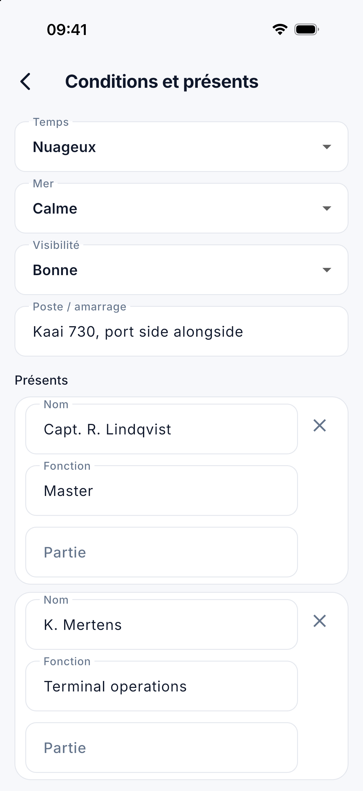
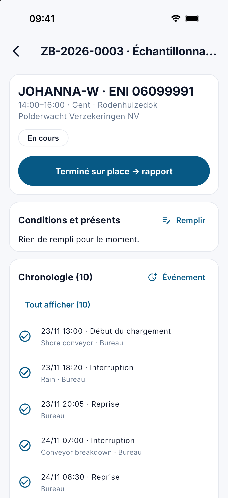
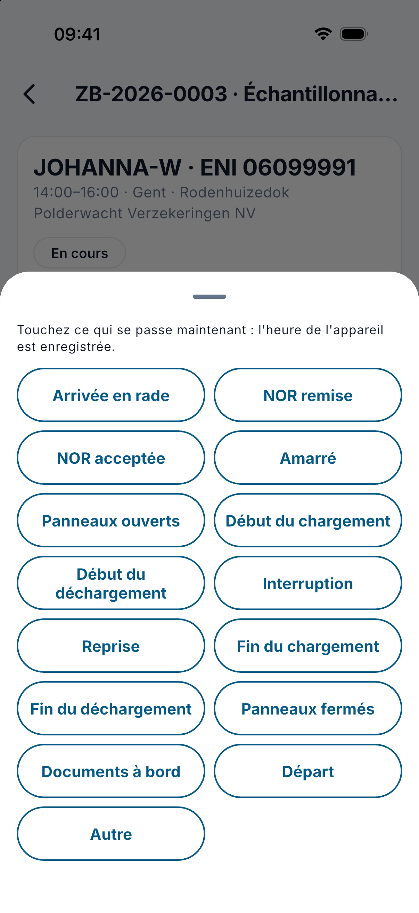
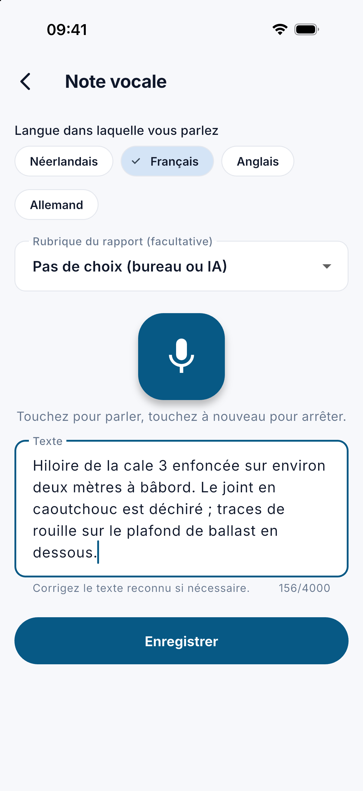
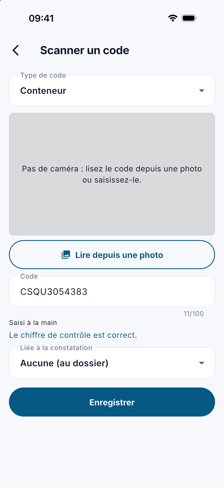
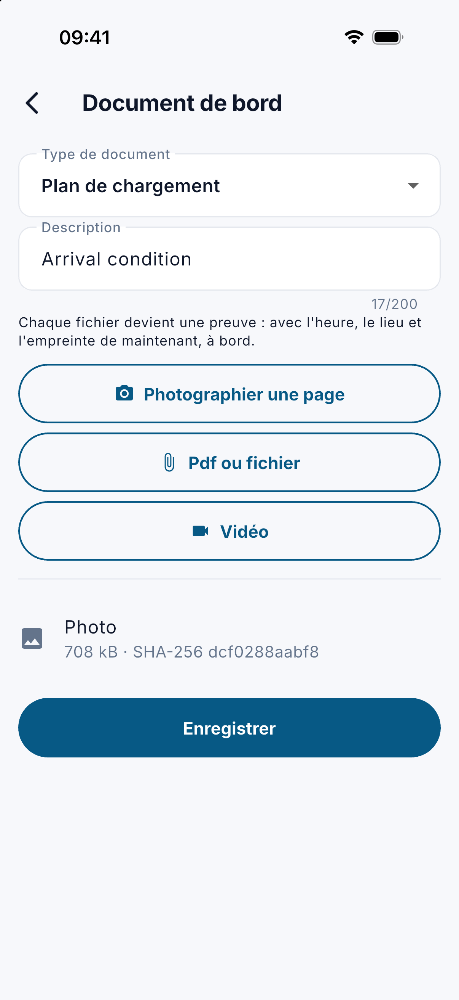

# Consigner à bord

Outre les constatations, vous consignez aussi à bord les conditions, les personnes présentes, la chronologie, des notes, des codes, des documents et des sondages. Chacun a sa carte sur le dossier, et tout fonctionne hors connexion.

## Conditions et présents

Sur la carte **Conditions et présents**, vous consignez les conditions de l'expertise et les personnes présentes. Touchez **Remplir**.

{ width="320" }

1. Choisissez le **Temps**, la **Mer** et la **Visibilité**. Avec **—**, vous laissez un choix vide.
2. Remplissez éventuellement **Poste / amarrage**, par exemple *Kaai 730, port side alongside*.
3. Sous **Présents**, touchez **Ajouter un présent** et remplissez le **Nom**, et éventuellement la **Fonction** et la **Partie** que la personne représente. La croix retire un présent.
4. Touchez **Enregistrer**.

Un présent avec une fonction ou une partie doit aussi avoir un nom ; sinon l'application dit *Donnez un nom à chaque présent, ou retirez la ligne.* Il peut y avoir au plus 30 présents. Le bureau voit et modifie les mêmes données sur le dossier. → [Dossiers](../dossiers.md#dossier)

### Le bureau a modifié entre-temps

Si le bureau a modifié les conditions ou les présents pendant que votre modification attendait encore sur l'appareil, Quaymark n'écrase rien. Votre modification figure alors en rouge dans **À envoyer**.

1. Touchez **Modifier**. En haut, il est écrit *Le bureau a modifié ceci entre-temps. Voici ce qui figure maintenant au bureau :*, avec ce que le bureau a rempli. Votre propre choix figure en dessous.
2. Reprenez tout ce que le bureau a rempli avec **Reprendre ceux du bureau**, ou choisissez champ par champ ce qui doit figurer.
3. Touchez **Enregistrer**.

Si vous choisissez exactement ce que le bureau a déjà, rien ne part : c'est déjà enregistré. → [Une action refusée](zonder-bereik.md#une-action-refusee)

## Chronologie

Pour un type d'expertise avec chronologie (le statement of facts), le dossier porte la carte **Chronologie**. Vous y suivez ce qui arrive au navire : de l'arrivée au départ.

{ width="320" }

{ width="320" }

1. Touchez **Événement**.
2. Touchez ce qui se passe maintenant, par exemple **Début du chargement** ou **Interruption**. L'heure de l'appareil est enregistrée.

L'application confirme l'enregistrement, et l'événement figure aussitôt sur la carte. Pour **Autre**, remplissez une **Description** et touchez **Enregistrer**.

Les choix sont : **Arrivée en rade**, **NOR remise**, **NOR acceptée**, **Amarré**, **Panneaux ouverts**, **Début du chargement**, **Début du déchargement**, **Interruption**, **Reprise**, **Fin du chargement**, **Fin du déchargement**, **Panneaux fermés**, **Documents à bord**, **Départ** et **Autre**.

La carte montre les cinq derniers événements ; **Tout afficher** les montre tous. Ce que le bureau a rempli porte la mention *Bureau*, avec les heures telles que le bureau les voit : à l'heure du site.

Dans l'application, vous pouvez seulement ajouter un événement. Le bureau corrige une erreur dans l'onglet **Chronologie**. → [Chronologie](../dossiers.md#chronologie)

## Notes vocales

Dictez une note au lieu de la taper. Touchez **Dicter** sur la carte **Notes**.

{ width="320" }

1. Choisissez la **Langue dans laquelle vous parlez**. L'application propose d'abord la langue de l'application.
2. Choisissez éventuellement la **Rubrique du rapport (facultative)**. Sans choix (**Pas de choix (bureau ou IA)**), le bureau ou l'IA choisit plus tard.
3. Touchez le micro et parlez. L'appareil transcrit aussitôt. Touchez à nouveau pour arrêter.
4. Corrigez le texte si nécessaire et touchez **Enregistrer**.

Seul le **texte** part vers Quaymark, avec l'heure et la position du début. Le son n'est pas conservé. S'il n'y a pas de position après 15 secondes (au fond d'une cale), la note part sans position.

Si l'appareil n'a pas de reconnaissance vocale, ou si l'application n'y est pas autorisée, l'écran le dit. Tapez alors la note, ou utilisez le micro du clavier. Au bureau, les notes figurent avec le rapport. → [Notes vocales](../dossiers.md#notes-vocales)

## Codes

Scannez des numéros de conteneur, des scellés et des échantillons. Touchez **Scanner** sur la carte **Codes**.

{ width="320" }

1. Choisissez le **Type de code** : **Conteneur**, **Scellé**, **Échantillon** ou **Autre code**.
2. Dirigez la caméra vers le code. Ou touchez **Lire depuis une photo** pour lire le code sur une photo de l'appareil, ou saisissez-le dans **Code**.
3. Sous **Liée à la constatation**, choisissez la constatation à laquelle le code appartient, ou laissez **Aucune (au dossier)**.
4. Touchez **Enregistrer**.

Sous le code figure la façon dont il est entré : **Scanné**, avec le format, ou **Saisi à la main**. Si vous corrigez un code scanné, il devient un code saisi.

Un **numéro de conteneur** comporte 4 lettres, la dernière U, J ou Z, et 7 chiffres. L'application recalcule le chiffre de contrôle et dit **Le chiffre de contrôle est correct.**, ou quel chiffre elle attendait. S'il est incorrect, l'application demande **Enregistrer quand même ?** : le code est alors enregistré avec la marque *chiffre de contrôle incorrect*, et la carte affiche un avertissement. → [Codes](../dossiers.md#codes)

## Documents de bord

Enregistrez le plan de chargement, le manifeste de cargaison, le journal de bord, un bon de livraison ou un certificat. Touchez **Ajouter** sur la carte **Documents de bord**.

{ width="320" }

1. Choisissez le **Type de document** : **Plan de chargement**, **Manifeste de cargaison**, **Journal de bord**, **Bon de livraison**, **Certificat** ou **Autre document**. Indiquez éventuellement une **Description**.
2. Ajoutez les fichiers :
    - **Photographier une page** : une photo par page ;
    - **Pdf ou fichier** : un pdf ou une photo déjà sur l'appareil ;
    - **Vidéo** : **Filmer une vidéo** ou **Choisir une vidéo**.
3. Touchez **Enregistrer**.

Une photo ou un pdf fait au plus 50 Mo, une vidéo au plus 200 Mo (mp4 ou mov). Chaque fichier devient une preuve comme une photo : avec l'heure, le lieu et l'empreinte du moment où vous l'ajoutez. La liste affiche la taille et le début de l'empreinte. Si vous n'enregistrez pas, l'application efface à nouveau les fichiers de l'appareil. → [Documents de bord](../dossiers.md#documents-de-bord)

## Expertise de soutes

Pour un type d'expertise avec expertise de soutes, le dossier porte la carte **Expertise de soutes**. Touchez-la pour voir les soutes du navire.

<!-- AFBEELDING: het scherm Bunker survey met tanks (app-bunker-fr) -->

1. Choisissez en haut **Avant** ou **Après** le soutage.
2. Touchez une soute. Une soute pas encore sondée indique *pas encore sondée*.
3. Indiquez le sondage : **Produit**, **Méthode** (**Sondage** ou **Creux**), **Mesuré (cm)**, **Correction assiette/gîte (cm)**, **Volume de la table (m³)**, **Température (°C)** et éventuellement la **Densité 15 °C (kg/m³), vide = BDN**.
4. Touchez **Enregistrer**.

Le volume et la température sont obligatoires. L'application affiche une **Estimation** en tonnes comme aide sur place ; Quaymark recalcule lui-même. Une soute que le navire n'avait pas encore s'ajoute avec **Ajouter une soute**.

Un sondage commence avec les valeurs du précédent. Une correction est un nouveau sondage : le dernier par soute compte. → [Expertise de soutes](../dossiers.md#expertise-de-soutes)

### Instruments de mesure

Sous les sondages figure le bloc **Instruments de mesure** : vous y choisissez les instruments utilisés pour le sondage, comme le thermomètre et le ruban de sonde.

1. Touchez **Choisir l'instrument**.
2. Touchez l'instrument. En haut figurent les instruments **Proposés pour les soutes**, en dessous les **Autres instruments**. Chaque instrument indique l'état de son étalonnage : **Valide**, **Expire bientôt**, **Expiré** ou **Jamais étalonné**.

Vous pouvez quand même choisir un instrument dont l'étalonnage est expiré, ou qui n'en a pas. L'application avertit : *Vous pouvez mesurer normalement : le rapport le mentionne.* Seul le bureau peut retirer un instrument choisi. → [Instruments de mesure](../meetapparatuur.md#lors-dune-mesure)

## Voir aussi

- [Le dossier](dossier.md)
- [Hors connexion](zonder-bereik.md)
