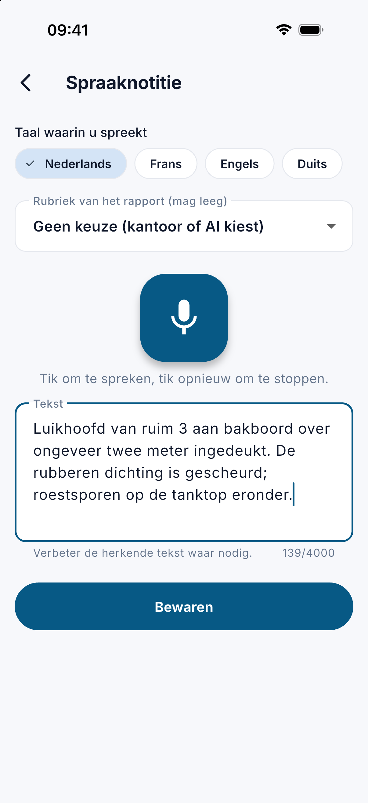
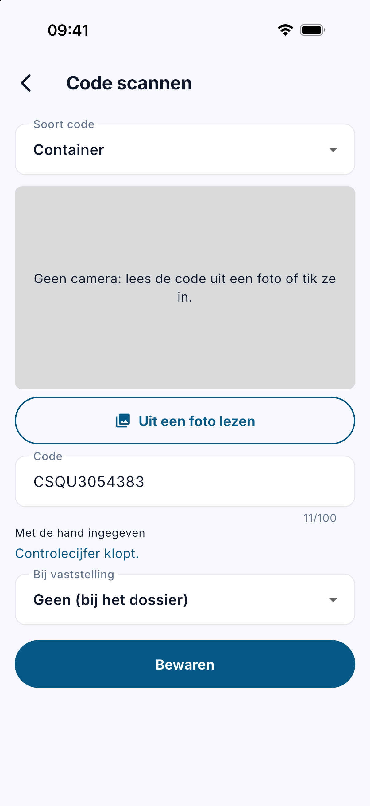
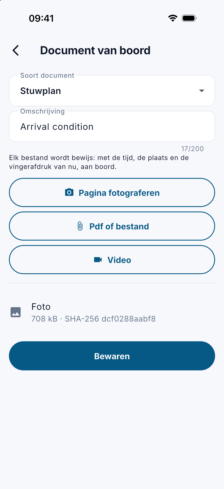

# Aan boord vastleggen

Naast vaststellingen legt u aan boord ook notities, codes, documenten en peilingen vast. Elk heeft zijn kaart op het dossier, en alles werkt zonder bereik.

## Spraaknotities

Spreek een notitie in, in plaats van te typen. Tik op **Inspreken** op de kaart **Notities**.

{ width="320" }

1. Kies de **Taal waarin u spreekt**. De app kiest eerst de taal van de app.
2. Kies eventueel de **Rubriek van het rapport (mag leeg)**. Kiest u niets (**Geen keuze (kantoor of AI kiest)**), dan kiest kantoor of de AI later.
3. Tik op de microfoon en spreek. Het toestel schrijft meteen uit. Tik opnieuw om te stoppen.
4. Verbeter de tekst waar nodig en tik op **Bewaren**.

Enkel de **tekst** gaat naar Quaymark, met het tijdstip en de positie van het begin. Het geluid wordt niet bewaard. Is er na 15 seconden geen positie (diep in een ruim), dan gaat de notitie zonder positie mee.

Kent het toestel geen spraakherkenning, of staat de app ze niet toe, dan zegt het scherm dat. Typ de notitie dan, of gebruik de microfoon van het toetsenbord. Op kantoor staan de notities bij het rapport. → [Spraaknotities](../dossiers.md#spraaknotities)

## Codes

Scan containernummers, zegels en stalen. Tik op **Scannen** op de kaart **Codes**.

{ width="320" }

1. Kies de **Soort code**: **Container**, **Zegel**, **Staal** of **Andere code**.
2. Richt de camera op de code. Of tik op **Uit een foto lezen** om de code uit een foto van het toestel te halen, of tik ze in bij **Code**.
3. Kies bij **Bij vaststelling** de vaststelling waar de code bij hoort, of laat **Geen (bij het dossier)** staan.
4. Tik op **Bewaren**.

Onder de code staat hoe ze binnenkwam: **Gescand**, met het formaat, of **Met de hand ingegeven**. Verbetert u een gescande code, dan wordt ze een ingetikte code.

Een **containernummer** is 4 letters, de laatste U, J of Z, en 7 cijfers. De app rekent het controlecijfer na en zegt **Controlecijfer klopt.**, of welk cijfer ze verwachtte. Klopt het niet, dan vraagt de app **Toch bewaren?**: de code komt er dan in met het merkteken *controlecijfer klopt niet*, en op de kaart staat een waarschuwing. → [Codes](../dossiers.md#codes)

## Documenten van boord

Leg het stuwplan, het cargo manifest, het logboek, een leveringsbon of een certificaat vast. Tik op **Toevoegen** op de kaart **Documenten van boord**.

{ width="320" }

1. Kies de **Soort document**: **Stuwplan**, **Cargo manifest**, **Logboek**, **Leveringsbon**, **Certificaat** of **Ander document**. Vul eventueel een **Omschrijving** in.
2. Voeg de bestanden toe:
    - **Pagina fotograferen**: een foto per pagina;
    - **Pdf of bestand**: een pdf of foto die al op het toestel staat;
    - **Video**: **Video opnemen** of **Video kiezen**.
3. Tik op **Bewaren**.

Een foto of pdf mag hoogstens 50 MB zijn, een video hoogstens 200 MB (mp4 of mov). Elk bestand wordt bewijs zoals een foto: met het tijdstip, de plaats en de vingerafdruk van het moment waarop u het toevoegt. In de lijst staan de grootte en het begin van de vingerafdruk. Bewaart u niet, dan wist de app de bestanden weer van het toestel. → [Documenten van boord](../dossiers.md#documenten-van-boord)

## Bunker survey

Bij een soort survey met bunker survey staat op het dossier de kaart **Bunker survey**. Tik erop om de brandstoftanks van het schip te zien.

<!-- AFBEELDING: het scherm Bunker survey met tanks (app-bunker) -->

1. Kies bovenaan **Vóór** of **Na** het bunkeren.
2. Tik op een tank. Een tank die nog niet gepeild is, zegt *nog niet gepeild*.
3. Vul de peiling in: **Product**, **Methode** (**Peiling** of **Ullage**), **Gemeten (cm)**, **Correctie trim/slagzij (cm)**, **Volume uit de tabel (m³)**, **Temperatuur (°C)** en eventueel de **Densiteit 15 °C (kg/m³), leeg = BDN**.
4. Tik op **Bewaren**.

Volume en temperatuur zijn verplicht. De app toont een **Schatting** in ton als hulp ter plaatse; Quaymark rekent zelf opnieuw. Een tank die het schip nog niet had, voegt u toe met **Tank toevoegen**.

Een peiling begint met de waarden van de vorige. Een verbetering is een nieuwe peiling: de laatste per tank telt. → [Bunker survey](../dossiers.md#bunker-survey)

## Zie ook

- [Het dossier](dossier.md)
- [Zonder bereik](zonder-bereik.md)
