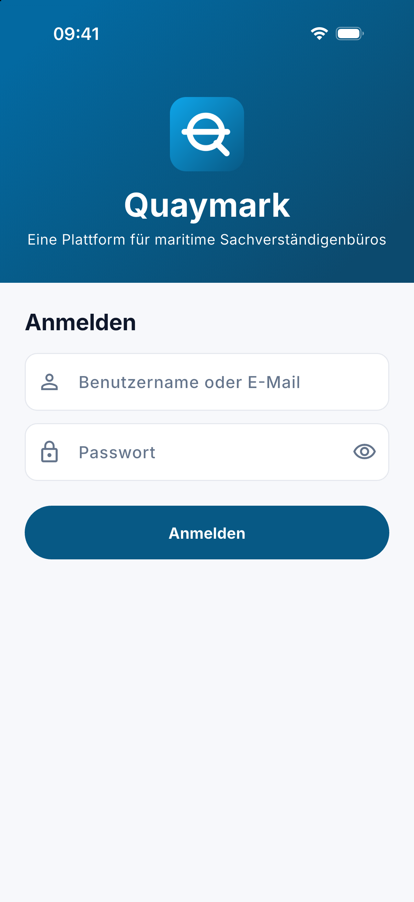
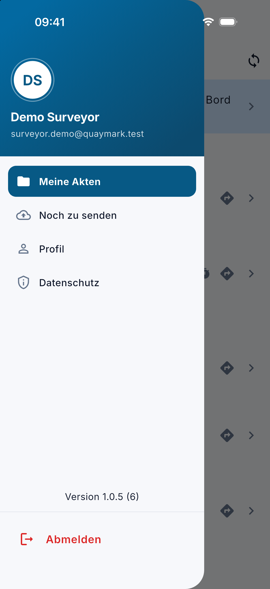
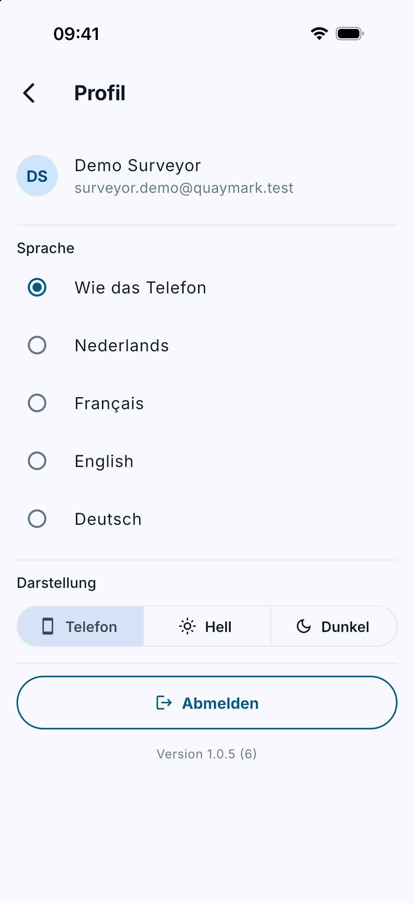

# Erste Schritte mit der Feld-App

Mit der Feld-App **Quaymark** arbeitet der Sachverständige an Bord: Er sieht die ihm zugewiesenen Akten, erfasst Feststellungen mit Fotos, beantwortet die Checkliste, lässt unterschreiben und erfasst seine Zeit. Was er tut, steht zuerst auf dem Gerät und geht ans Büro, sobald eine Verbindung besteht. Die App läuft auf einem Telefon und einem Tablet, unter iOS und Android, auf Niederländisch, Französisch, Englisch und Deutsch.

## Zugang

Jeder Benutzer des Büros kann sich in der Feld-App anmelden, mit demselben Benutzernamen oder derselben E-Mail-Adresse und demselben Passwort wie in der Web-App. Auch ein Freiberufler mit der Rolle Freiberufler kann das. → [Freiberufler](../freelancers.md#die-rolle-freiberufler)

Die App zeigt nur die **offenen Akten, deren Sachverständiger Sie sind**. Das Büro weist Ihnen eine Akte zu, in der Akte oder in der [Planung](../planning.md).

Noch kein Konto? Fragen Sie den Administrator Ihres Büros.

## Installieren

Installieren Sie die App **Quaymark** aus dem App Store oder von Google Play. Es gibt eine App für alle Büros: Sie wählen weder Büro noch Server, Ihr Konto bestimmt, zu welchem Büro Sie gehören.

## Anmelden

{ width="320" }

1. Öffnen Sie die App.
2. Geben Sie unter **Benutzername oder E-Mail** und **Passwort** Ihre Zugangsdaten ein. Das Auge neben dem Passwort zeigt, was Sie getippt haben.
3. Tippen Sie auf **Anmelden**.

Nutzen Sie die **Zwei-Schritt-Verifizierung**, fragt die App danach einen **Code**: aus Ihrer Authenticator-App oder aus einer E-Mail, die Sie gerade erhalten haben. Haben Sie Ihren Authenticator nicht zur Hand, tippen Sie auf **Ich verwende einen Wiederherstellungscode**. Tippen Sie auf **Bestätigen**. **Zurück zur Anmeldung** beginnt von vorn. → [Zwei-Faktor-Authentifizierung](../aan-de-slag.md#zwei-faktor-authentifizierung)

Sie bleiben angemeldet. Die App öffnet sich mit [Meine Akten](mijn-dossiers.md).

Passwort vergessen? Fordern Sie auf dem Anmeldebildschirm der Web-App mit **Passwort vergessen?** ein neues an. → [Anmelden](../aan-de-slag.md#anmelden)

## Das Menü

{ width="320" }

Oben links öffnet ☰ das Menü:

| Menü | Was |
|---|---|
| **Meine Akten** | Ihre offenen Akten, nach Tag: siehe [Meine Akten](mijn-dossiers.md) |
| **Noch zu senden** | Was noch auf Ihrem Gerät wartet, mit der Anzahl: siehe [Offline](zonder-bereik.md) |
| **Profil** | Ihr Name, die Sprache, die Darstellung und das Abmelden |
| **Datenschutz** | Die Datenschutzerklärung auf quaymark.eu, in der Sprache der App |

Unten im Menü stehen **Abmelden** und die Version der App. Fragt das Büro, welche Version Sie haben, steht sie dort.

## Profil

{ width="320" }

- **Sprache**: **Wie das Telefon** oder eine der vier Sprachen. Spricht Ihr Telefon eine andere Sprache, zeigt die App Englisch. Die Sprache gilt für die Bildschirme der App. Was in den Bericht kommt, etwa die Erklärung, die der Unterzeichner liest, und die Standardbefunde, steht in der Sprache der Akte.
- **Darstellung**: **Telefon** (wie das Gerät), **Hell** oder **Dunkel**.
- **Abmelden**: siehe unten.

## Abmelden

Tippen Sie auf **Abmelden**, im Menü oder im Profil. Das Abmelden gilt nur für dieses Gerät.

Steht auf dem Gerät noch etwas, das nicht gesendet wurde, sagt die App, wie viel. Es bleibt gespeichert und wird gesendet, sobald **Sie** sich wieder anmelden. Wählen Sie **Abbrechen**, um angemeldet zu bleiben, oder **Trotzdem abmelden**. Meldet sich ein Kollege auf demselben Gerät an, sieht er Ihre Akten nicht, und Ihre Arbeit wird nicht unter seinem Namen gesendet.

## Aktualisieren Sie Quaymark

Ist die App zu alt, zeigt sie **Aktualisieren Sie Quaymark** mit der erforderlichen Version. Tippen Sie auf **Aktualisieren**: Der App Store oder Google Play öffnet sich, und dort aktualisieren Sie die App. Was noch nicht gesendet wurde, bleibt auf dem Gerät und wird nach der Aktualisierung gesendet.

## Häufige Fehler

!!! warning "Die Anmeldung klappt nicht"
    Prüfen Sie Benutzername und Passwort: Sie sind dieselben wie in der Web-App. Klappt es dort, aber nicht in der App, fragen Sie den Administrator Ihres Büros, ob Ihr Konto aktiv ist.

!!! warning "Ihre Anmeldung ist nicht mehr gültig"
    Melden Sie sich erneut an. Klappt das nicht, wurde Ihr Zugang vielleicht entzogen: Fragen Sie Ihr Büro. Was noch nicht gesendet war, bleibt auf dem Gerät.

!!! warning "Meine Akten bleibt leer"
    Steht dort *Ihnen sind keine offenen Akten zugewiesen.*, sind Sie bei keiner offenen Akte der Sachverständige. Bitten Sie das Büro, Sie zuzuweisen.

## Siehe auch

- [Meine Akten](mijn-dossiers.md)
- [Die Akte](dossier.md)
- [Offline](zonder-bereik.md)
