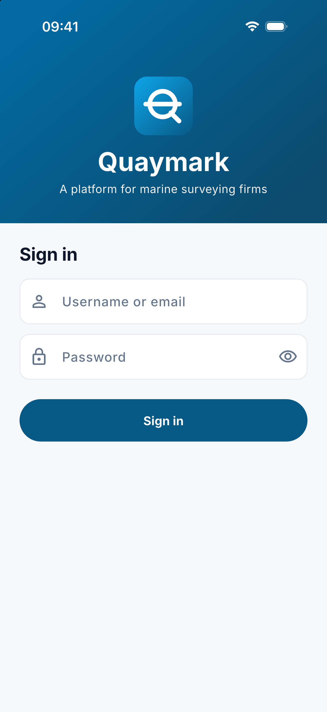
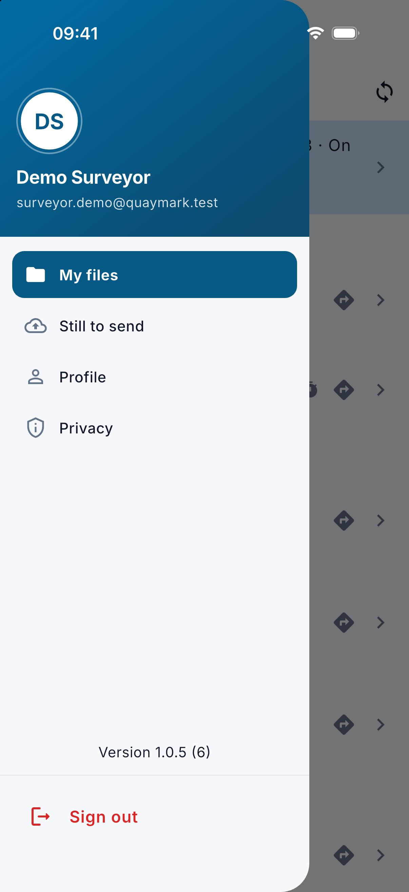
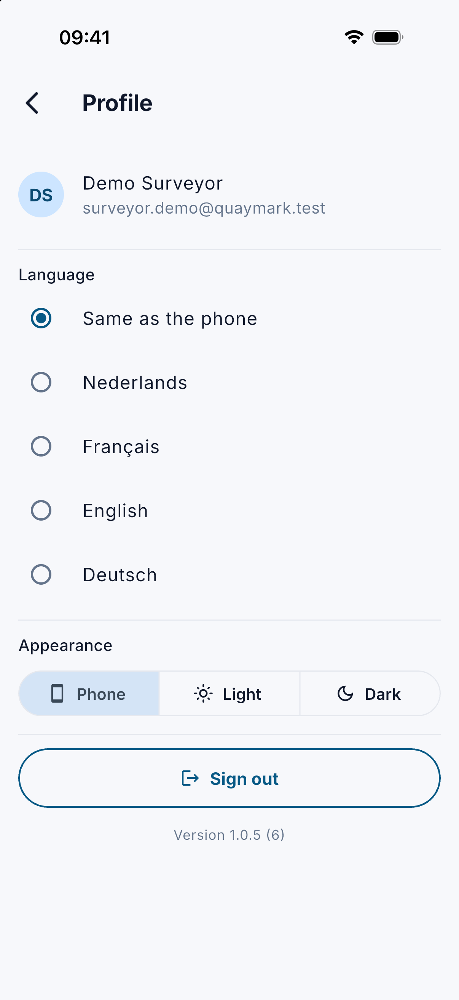

# Getting started with the field app

With the **Quaymark** field app, the surveyor works on board: they see the files assigned to them, record findings with photos, answer the checklist, get signatures and record their time. What they do stays on the device first and goes to the office as soon as there is a connection. The app works on a phone and on a tablet, on iOS and on Android, in Dutch, French, English and German.

## Access

Every user of the firm can sign in to the field app, with the same username or email address and the same password as in the web app. A freelancer with the Freelancer role can too. → [Freelancers](../freelancers.md#the-freelancer-role)

The app only shows the **open files of which you are the surveyor**. The office assigns a file to you, on the file or in the [Schedule](../planning.md).

No account yet? Ask your firm's administrator.

## Installing

Install the **Quaymark** app from the App Store or Google Play. There is one app for every firm: you choose no firm or server, your account determines which firm you belong to.

## Signing in

{ width="320" }

1. Open the app.
2. Enter your **Username or email** and your **Password**. The eye next to the password shows what you typed.
3. Tap **Sign in**.

If you use **two-step verification**, the app then asks for a **Code**: from your authenticator app, or from an email you just received. Don't have your authenticator at hand? Tap **I am using a recovery code**. Tap **Confirm**. **Back to sign-in** starts over. → [Two-factor authentication](../aan-de-slag.md#two-factor-authentication)

You stay signed in. The app opens on [My files](mijn-dossiers.md).

Forgot your password? Request a new one on the sign-in screen of the web app, with **Forgot your password?**. → [Sign in](../aan-de-slag.md#sign-in)

## The menu

{ width="320" }

At the top left, ☰ opens the menu:

| Menu | What |
|---|---|
| **My files** | Your open files, by day: see [My files](mijn-dossiers.md) |
| **Still to send** | What is still waiting on your device, with the number: see [Offline](zonder-bereik.md) |
| **Profile** | Your name, the language, the appearance and signing out |
| **Privacy** | The privacy statement on quaymark.eu, in the language of the app |

At the bottom of the menu are **Sign out** and the version of the app. If the office asks which version you have, it is there.

## Profile

{ width="320" }

- **Language**: **Same as the phone**, or one of the four languages. If your phone uses another language, the app shows English. The language applies to the screens of the app. What goes into the report, such as the statement the signatory reads and the standard findings, is in the language of the file.
- **Appearance**: **Phone** (same as the device), **Light** or **Dark**.
- **Sign out**: see below.

## Signing out

Tap **Sign out**, in the menu or on the profile. Signing out only applies to this device.

If something on the device has not been sent yet, the app says how many items. They stay saved and are sent as soon as **you** sign in again. Choose **Cancel** to stay signed in, or **Sign out anyway**. If a colleague signs in on the same device, they do not see your files, and your work is not sent under their name.

## Update Quaymark

If the app is too old, it shows **Update Quaymark**, with the version required. Tap **Update**: the App Store or Google Play opens, and you update the app there. Anything not sent yet stays on the device and is sent after the update.

## Common mistakes

!!! warning "Signing in fails"
    Check the username and password: they are the same as in the web app. If it works there but not in the app, ask your firm's administrator whether your account is active.

!!! warning "Your sign-in is no longer valid"
    Sign in again. If that fails, your access may have been withdrawn: ask your firm. Anything not sent yet stays on the device.

!!! warning "My files stays empty"
    If it says *No open files assigned to you.*, you are not the surveyor of any open file. Ask the office to assign you.

## See also

- [My files](mijn-dossiers.md)
- [The file](dossier.md)
- [Offline](zonder-bereik.md)
