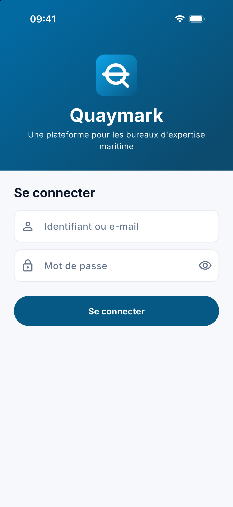
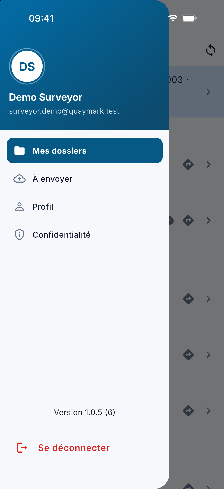
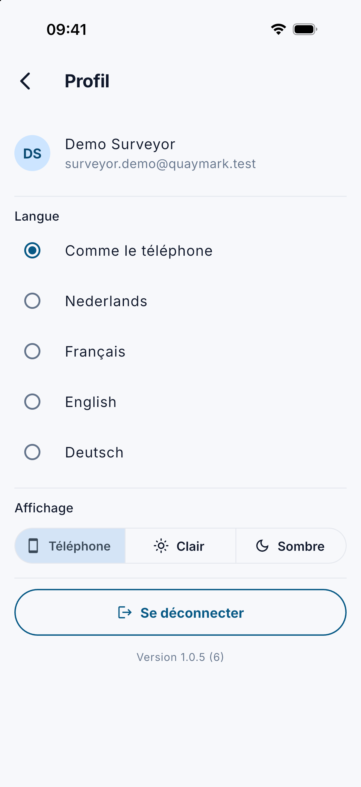

# Premiers pas avec l'application de terrain

Avec l'application de terrain **Quaymark**, l'expert travaille à bord : il voit les dossiers qui lui sont attribués, enregistre des constatations avec photos, répond à la check-list, fait signer et enregistre son temps. Ce qu'il fait reste d'abord sur l'appareil et part vers le bureau dès qu'il y a du réseau. L'application fonctionne sur un téléphone et sur une tablette, sous iOS et sous Android, en néerlandais, français, anglais et allemand.

## Accès

Chaque utilisateur du bureau peut se connecter à l'application de terrain, avec le même identifiant ou la même adresse e-mail et le même mot de passe que dans l'application web. Un freelance avec le rôle Freelance le peut aussi. → [Freelances](../freelancers.md#le-role-freelance)

L'application n'affiche que les **dossiers ouverts dont vous êtes l'expert**. Le bureau vous attribue un dossier, sur le dossier ou dans le [Planning](../planning.md).

Vous n'avez pas encore de compte ? Demandez-le à l'administrateur de votre bureau.

## Installer

Installez l'application **Quaymark** depuis l'App Store ou Google Play. Il y a une seule application pour tous les bureaux : vous ne choisissez ni bureau ni serveur, votre compte détermine à quel bureau vous appartenez.

## Se connecter

{ width="320" }

1. Ouvrez l'application.
2. Indiquez votre **Identifiant ou e-mail** et votre **Mot de passe**. L'œil à côté du mot de passe affiche ce que vous avez tapé.
3. Touchez **Se connecter**.

Si vous utilisez la **vérification en deux étapes**, l'application demande ensuite un **Code** : de votre application d'authentification, ou d'un e-mail que vous venez de recevoir. Vous n'avez pas votre authentificateur sous la main ? Touchez **J'utilise un code de récupération**. Touchez **Confirmer**. **Retour à la connexion** recommence depuis le début. → [Double authentification](../aan-de-slag.md#double-authentification)

Vous restez connecté. L'application s'ouvre sur [Mes dossiers](mijn-dossiers.md).

Mot de passe oublié ? Demandez-en un nouveau sur l'écran de connexion de l'application web, avec **Mot de passe oublié ?**. → [Connexion](../aan-de-slag.md#connexion)

## Le menu

{ width="320" }

En haut à gauche, ☰ ouvre le menu :

| Menu | Quoi |
|---|---|
| **Mes dossiers** | Vos dossiers ouverts, par jour : voir [Mes dossiers](mijn-dossiers.md) |
| **À envoyer** | Ce qui attend encore sur votre appareil, avec le nombre : voir [Hors connexion](zonder-bereik.md) |
| **Profil** | Votre nom, la langue, l'affichage et la déconnexion |
| **Confidentialité** | La déclaration de confidentialité sur quaymark.eu, dans la langue de l'application |

En bas du menu figurent **Se déconnecter** et la version de l'application. Si le bureau vous demande quelle version vous avez, elle est là.

## Profil

{ width="320" }

- **Langue** : **Comme le téléphone**, ou l'une des quatre langues. Si votre téléphone parle une autre langue, l'application s'affiche en anglais. La langue vaut pour les écrans de l'application. Ce qui va dans le rapport, comme la déclaration que lit le signataire et les constats standard, est dans la langue du dossier.
- **Affichage** : **Téléphone** (comme l'appareil), **Clair** ou **Sombre**.
- **Se déconnecter** : voir ci-dessous.

## Se déconnecter

Touchez **Se déconnecter**, dans le menu ou sur le profil. La déconnexion ne vaut que pour cet appareil.

S'il reste sur l'appareil quelque chose qui n'a pas été envoyé, l'application dit combien. Cela reste enregistré et part dès que **vous** vous reconnectez. Choisissez **Annuler** pour rester connecté, ou **Se déconnecter quand même**. Si un collègue se connecte sur le même appareil, il ne voit pas vos dossiers, et votre travail ne part pas sous son nom.

## Mettez Quaymark à jour

Si l'application est trop ancienne, elle affiche **Mettez Quaymark à jour**, avec la version nécessaire. Touchez **Mettre à jour** : l'App Store ou Google Play s'ouvre, et vous y mettez l'application à jour. Ce qui n'est pas encore envoyé reste sur l'appareil et part après la mise à jour.

## Erreurs fréquentes

!!! warning "La connexion échoue"
    Vérifiez l'identifiant et le mot de passe : ce sont les mêmes que dans l'application web. Si cela fonctionne là et pas dans l'application, demandez à l'administrateur de votre bureau si votre compte est actif.

!!! warning "Votre connexion n'est plus valable"
    Reconnectez-vous. Si cela ne fonctionne pas, votre accès a peut-être été retiré : demandez à votre bureau. Ce qui n'était pas encore envoyé reste sur l'appareil.

!!! warning "Mes dossiers reste vide"
    S'il est écrit *Aucun dossier ouvert ne vous est attribué.*, vous n'êtes l'expert d'aucun dossier ouvert. Demandez au bureau de vous l'attribuer.

## Voir aussi

- [Mes dossiers](mijn-dossiers.md)
- [Le dossier](dossier.md)
- [Hors connexion](zonder-bereik.md)
