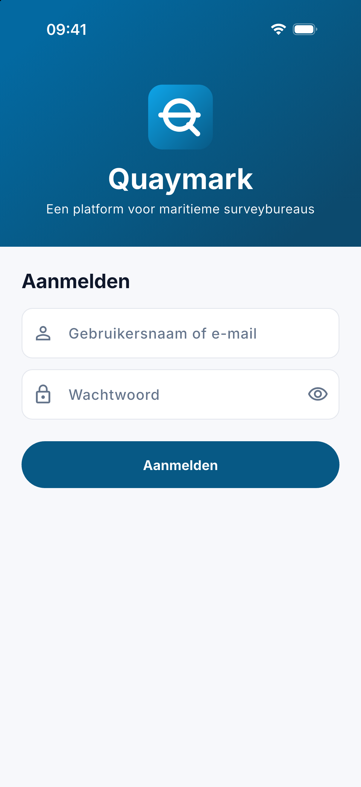
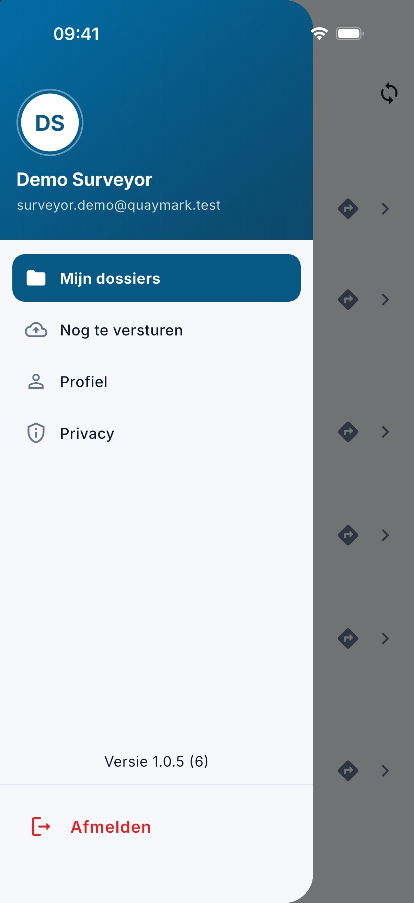
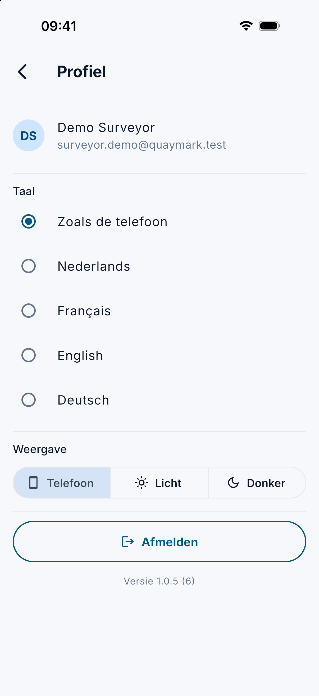

# Aan de slag met de veldapp

Met de veldapp **Quaymark** werkt de surveyor aan boord: hij ziet de dossiers die aan hem toegewezen zijn, legt vaststellingen met foto's vast, beantwoordt de checklist, laat tekenen en registreert zijn tijd. Wat hij doet, staat eerst op het toestel en vertrekt naar kantoor zodra er bereik is. De app werkt op een telefoon en op een tablet, met iOS en met Android, in het Nederlands, Frans, Engels en Duits.

## Toegang

Elke gebruiker van het bureau kan zich aanmelden in de veldapp, met dezelfde gebruikersnaam of hetzelfde e-mailadres en hetzelfde wachtwoord als in de webapp. Ook een freelancer met de rol Freelancer kan dat. → [Freelancers](../freelancers.md#de-rol-freelancer)

De app toont enkel de **open dossiers waarvan u de surveyor bent**. Een dossier wijst u toe op kantoor, op het dossier of in de [Planning](../planning.md).

Hebt u nog geen account, vraag het dan aan ADM Concept.

## Installeren

Installeer de app **Quaymark** uit de App Store of uit Google Play. Er is één app voor elk bureau: u kiest geen bureau of server, uw account bepaalt bij welk bureau u hoort.

## Aanmelden

{ width="320" }

1. Open de app.
2. Vul uw **Gebruikersnaam of e-mail** en uw **Wachtwoord** in. Het oog naast het wachtwoord toont wat u typte.
3. Tik op **Aanmelden**.

Gebruikt u **tweestapsverificatie**, dan vraagt de app daarna een **Code**: uit uw authenticator-app, of uit een mail die u net kreeg. Hebt u uw authenticator niet bij de hand, tik dan op **Ik gebruik een herstelcode**. Tik op **Bevestigen**. Met **Terug naar aanmelden** begint u opnieuw. → [Tweestapsverificatie](../aan-de-slag.md#tweestapsverificatie)

U blijft aangemeld. De app opent op [Mijn dossiers](mijn-dossiers.md).

Uw wachtwoord vergeten? Vraag een nieuw aan op het aanmeldscherm van de webapp, met **Wachtwoord vergeten?**. → [Aanmelden](../aan-de-slag.md#aanmelden)

## Het menu

{ width="320" }

Linksboven opent ☰ het menu:

| Menu | Wat |
|---|---|
| **Mijn dossiers** | Uw open dossiers, per dag: zie [Mijn dossiers](mijn-dossiers.md) |
| **Nog te versturen** | Wat nog op uw toestel wacht, met het aantal: zie [Zonder bereik](zonder-bereik.md) |
| **Profiel** | Uw naam, de taal, de weergave en afmelden |
| **Privacy** | De privacyverklaring op quaymark.eu, in de taal van de app |

Onderaan het menu staan **Afmelden** en de versie van de app. Vraagt kantoor welke versie u hebt, dan staat ze daar.

## Profiel

{ width="320" }

- **Taal**: **Zoals de telefoon**, of een van de vier talen. Spreekt uw telefoon een andere taal, dan toont de app Engels. De taal geldt voor de schermen van de app. Wat in het rapport komt, zoals de verklaring die de ondertekenaar leest en de standaardbevindingen, staat in de taal van het dossier.
- **Weergave**: **Telefoon** (zoals het toestel), **Licht** of **Donker**.
- **Afmelden**: zie hieronder.

## Afmelden

Tik op **Afmelden**, in het menu of op het profiel. Afmelden geldt enkel voor dit toestel.

Staat er nog iets op het toestel dat niet verstuurd is, dan zegt de app hoeveel. Het blijft bewaard en vertrekt zodra **u** zich opnieuw aanmeldt. Kies **Annuleren** om aangemeld te blijven, of **Toch afmelden**. Meldt een collega zich op hetzelfde toestel aan, dan ziet hij uw dossiers niet, en uw werk vertrekt niet onder zijn naam.

## Werk Quaymark bij

Is de app te oud, dan toont ze **Werk Quaymark bij**, met de versie die nodig is. Tik op **Bijwerken**: de App Store of Google Play opent, en daar werkt u de app bij. Wat nog niet verstuurd is, blijft op het toestel en vertrekt na de update.

## Veelgemaakte fouten

!!! warning "Aanmelden lukt niet"
    Kijk de gebruikersnaam en het wachtwoord na: ze zijn dezelfde als in de webapp. Lukt het daar wel en in de app niet, vraag dan aan ADM Concept of uw account actief is.

!!! warning "Uw aanmelding is niet meer geldig"
    Meld u opnieuw aan. Lukt dat niet, dan is uw toegang misschien ingetrokken: vraag het aan uw bureau. Wat nog niet verstuurd was, blijft op het toestel.

!!! warning "Mijn dossiers blijft leeg"
    Staat er *Geen open dossiers aan u toegewezen.*, dan bent u van geen enkel open dossier de surveyor. Vraag kantoor u toe te wijzen.

## Zie ook

- [Mijn dossiers](mijn-dossiers.md)
- [Het dossier](dossier.md)
- [Zonder bereik](zonder-bereik.md)
