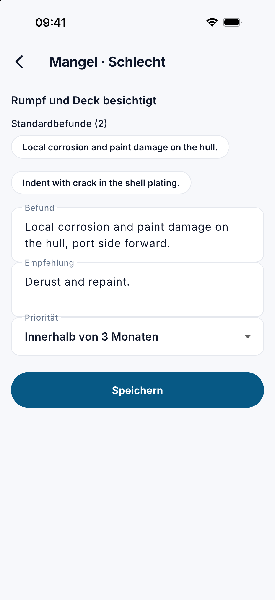

# Die Checkliste

Hat die Besichtigungsart eine Checkliste, trägt die Akte die Karte **Checkliste** mit der Anzahl beantworteter Punkte. Tippen Sie auf die Karte, um die Checkliste zu öffnen.

{ width="320" }

## Antworten

Unter jedem Punkt stehen die Schaltflächen der Skala. Die Besichtigungsart bestimmt, welche:

- bei einer Kontrolle: **In Ordnung**, **Nicht in Ordnung** und **Entfällt**;
- bei einer Zustandsbesichtigung: **Gut**, **Befriedigend**, **Mangelhaft**, **Schlecht** und **Entfällt**.

Eine gute Antwort speichern Sie mit einem Tippen.

Jede Antwort wird **hinzugefügt**: Eine neue Antwort ersetzt die vorige nicht, sie kommt dazu. Die letzte zählt, zu dem Zeitpunkt, an dem Sie sie gegeben haben, auch wenn sie später ankommt. Das Büro sieht die vorigen Antworten, mit wem und wann.

## Ein Foto bei einem Punkt

Unter einem beantworteten Punkt stehen **Foto** und **Aus der Mediathek**, wie bei einer neuen Feststellung. Ein Punkt ohne Antwort hat sie nicht: Antworten Sie zuerst, denn das Foto ist der Beweis dieser Antwort.

- Es gibt kein **Speichern**: Das Foto hängt sofort am Punkt. Solange das Gerät das Foto festhält (die Position kann bis zu 15 Sekunden dauern), dreht sich ein Rad auf der Schaltfläche.
- Unter dem Punkt steht, wie viele Fotos er hat, zum Beispiel *Foto erforderlich · 📷 2 · noch nicht gesendet*. Diese Zahl zählt die Fotos, die schon im Büro sind, auch bei einer früheren Antwort, und die noch auf dem Gerät warten.
- Das Foto gehört zur letzten Antwort, die die App kennt. Antworten Sie danach erneut, bleibt es bei der früheren Antwort; Büro und Bericht zeigen es trotzdem unter dem Punkt.
- Offline wird das Foto bei der nächsten Synchronisierung gesendet, nach seiner Antwort. Das Gerät hält dasselbe fest wie bei einer Feststellung: Uhrzeit, Position und Fingerabdruck. → [Was das Gerät bei einem Foto festhält](vaststellingen.md#was-das-gerat-bei-einem-foto-festhalt)

*Foto erforderlich* ist eine Erinnerung: Die App speichert eine Antwort auch ohne Foto. Im Büro fügen Sie mit **Fotos hinzufügen** noch Fotos hinzu. → [Checkliste](../dossiers.md#checkliste)

## Ein Mangel

Bei **Nicht in Ordnung**, **Mangelhaft** oder **Schlecht** öffnet sich der Bildschirm **Mangel**.

{ width="320" }

1. Tippen Sie bei Bedarf auf einen der **Standardbefunde** des Punktes: Er füllt **Befund** und **Empfehlung**, in der Sprache der Akte.
2. Passen Sie **Befund** und **Empfehlung** bei Bedarf an.
3. Wählen Sie die **Priorität**: **Sofort, vor dem Auslaufen**, **Innerhalb von 3 Monaten**, **Bei der nächsten Wartung** oder **Zur Information**.
4. Tippen Sie auf **Speichern**.

Unter dem Punkt stehen dann Priorität, Befund und Empfehlung, in Rot. Tippen Sie erneut auf einen Mangel, beginnt der Bildschirm mit dem Text des vorigen Mangels.

Die Standardbefunde kommen von Ihrem Büro, pro Besichtigungsart. → [Besichtigungsarten](../soorten-survey.md)

## Im Bericht

Die Mängel kommen mit ihrer Priorität und Empfehlung in den Bericht. Im Büro steht die Checkliste in der Registerkarte **Checkliste** der Akte. → [Checkliste](../dossiers.md#checkliste)

## Siehe auch

- [Feststellungen und Fotos](vaststellingen.md)
- [Die Akte](dossier.md)
