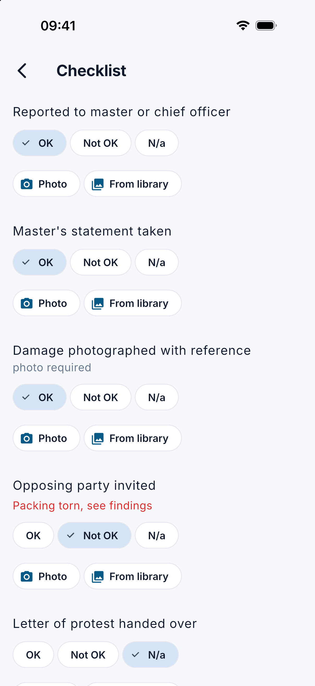
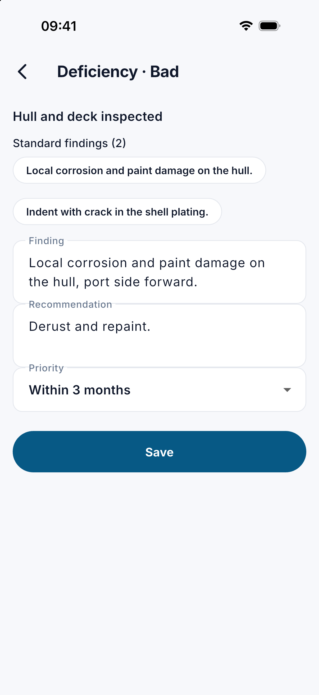

# The checklist

If the survey type has a checklist, the file has the **Checklist** card, showing how many items are answered. Tap the card to open the checklist.

{ width="320" }

## Answering

Below each item are the buttons of the scale. The survey type decides which:

- for an inspection: **OK**, **Not OK** and **N/a**;
- for a condition survey: **Good**, **Fair**, **Poor**, **Bad** and **N/a**.

A good answer is saved with one tap.

Every answer is **added**: a new answer does not replace the previous one, it comes on top of it. The last one counts, at the moment you gave it, even if it arrives later. The office sees the previous answers, with who and when.

## A photo with an item

Below an answered item are **Photo** and **From library**, as for a new finding. An item without an answer does not have them: answer first, because the photo is the evidence of that answer.

- There is no **Save**: the photo is attached to the item straight away. While the device records the photo (the position can take up to 15 seconds), a spinner turns on the button.
- Below the item you see how many photos it has, for example *photo required · 📷 2 · not sent yet*. That number counts the photos already at the office, including those of a previous answer, and those still waiting on the device.
- The photo belongs to the last answer the app knows. If you answer again afterwards, it stays with the previous answer; the office and the report still show it below the item.
- Offline, the photo is sent at the next sync, after its answer. The device records the same as for a finding: the time, the position and the fingerprint. → [What the device records with a photo](vaststellingen.md#what-the-device-records-with-a-photo)

*Photo required* is a reminder: the app also saves an answer without a photo. At the office you can still add photos with **Add photos**. → [Checklist](../dossiers.md#checklist)

## A deficiency

For **Not OK**, **Poor** or **Bad**, the **Deficiency** screen opens.

{ width="320" }

1. If you like, tap one of the item's **Standard findings**: it fills in the **Finding** and the **Recommendation**, in the language of the file.
2. Adjust the **Finding** and the **Recommendation** where needed.
3. Choose the **Priority**: **Immediate, before departure**, **Within 3 months**, **At the next maintenance** or **For information**.
4. Tap **Save**.

Below the item you then see the priority, the finding and the recommendation, in red. If you tap a deficiency again, the screen starts with the text of the previous deficiency.

The standard findings come from your firm, per survey type. → [Survey types](../soorten-survey.md)

## In the report

The deficiencies go into the report with their priority and recommendation. At the office the checklist is on the **Checklist** tab of the file. → [Checklist](../dossiers.md#checklist)

## See also

- [Findings and photos](vaststellingen.md)
- [The file](dossier.md)
