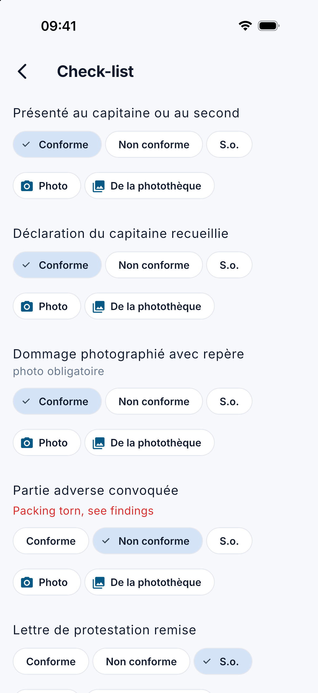
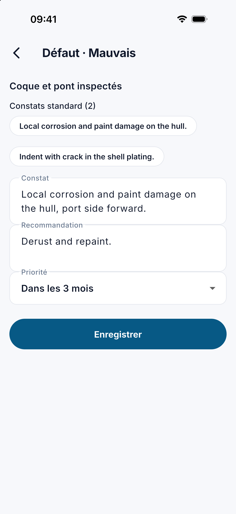

# La check-list

Si le type d'expertise a une check-list, le dossier porte la carte **Check-list**, avec le nombre de points qui ont une réponse. Touchez la carte pour ouvrir la check-list.

{ width="320" }

## Répondre

Sous chaque point figurent les boutons de l'échelle. Le type d'expertise détermine lesquels :

- pour un contrôle : **Conforme**, **Non conforme** et **S.o.** ;
- pour une expertise d'état : **Bon**, **Correct**, **Médiocre**, **Mauvais** et **S.o.**

Une bonne réponse s'enregistre d'une touche.

Chaque réponse est **ajoutée** : une nouvelle réponse ne remplace pas la précédente, elle s'y ajoute. La dernière compte, au moment où vous l'avez donnée, même si elle arrive plus tard. Le bureau voit les réponses précédentes, avec qui et quand.

## Une photo à un point

Sous un point répondu figurent **Photo** et **De la photothèque**, comme pour une nouvelle constatation. Un point sans réponse ne les a pas : répondez d'abord, car la photo est la preuve de cette réponse.

- Il n'y a pas d'**Enregistrer** : la photo est liée aussitôt au point. Tant que l'appareil enregistre la photo (la position peut prendre jusqu'à 15 secondes), une roue tourne sur le bouton.
- Sous le point figure le nombre de photos, par exemple *photo obligatoire · 📷 2 · pas encore envoyé*. Ce nombre compte les photos déjà au bureau, y compris celles d'une réponse précédente, et celles qui attendent encore sur l'appareil.
- La photo est liée à la dernière réponse que l'application connaît. Si vous répondez à nouveau ensuite, elle reste liée à la réponse précédente ; le bureau et le rapport l'affichent quand même sous le point.
- Hors connexion, la photo part à la synchronisation suivante, après sa réponse. L'appareil enregistre la même chose que pour une constatation : l'heure, la position et l'empreinte. → [Ce que l'appareil enregistre avec une photo](vaststellingen.md#ce-que-lappareil-enregistre-avec-une-photo)

*Photo obligatoire* est un rappel : l'application enregistre aussi une réponse sans photo. Au bureau, vous ajoutez encore des photos avec **Ajouter des photos**. → [Check-list](../dossiers.md#check-list)

## Un défaut

Pour **Non conforme**, **Médiocre** ou **Mauvais**, l'écran **Défaut** s'ouvre.

{ width="320" }

1. Touchez éventuellement l'un des **Constats standard** du point : il remplit le **Constat** et la **Recommandation**, dans la langue du dossier.
2. Adaptez le **Constat** et la **Recommandation** si nécessaire.
3. Choisissez la **Priorité** : **Immédiat, avant le départ**, **Dans les 3 mois**, **Au prochain entretien** ou **Pour information**.
4. Touchez **Enregistrer**.

Sous le point figurent alors la priorité, le constat et la recommandation, en rouge. Si vous touchez à nouveau un défaut, l'écran reprend le texte du défaut précédent.

Les constats standard viennent de votre bureau, par type d'expertise. → [Types d'expertise](../soorten-survey.md)

## Dans le rapport

Les défauts vont dans le rapport avec leur priorité et leur recommandation. Au bureau, la check-list figure dans l'onglet **Check-list** du dossier. → [Check-list](../dossiers.md#check-list)

## Voir aussi

- [Constatations et photos](vaststellingen.md)
- [Le dossier](dossier.md)
