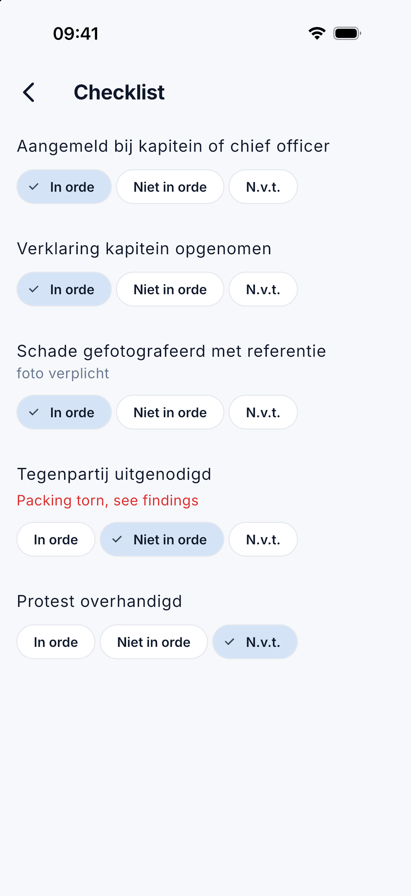
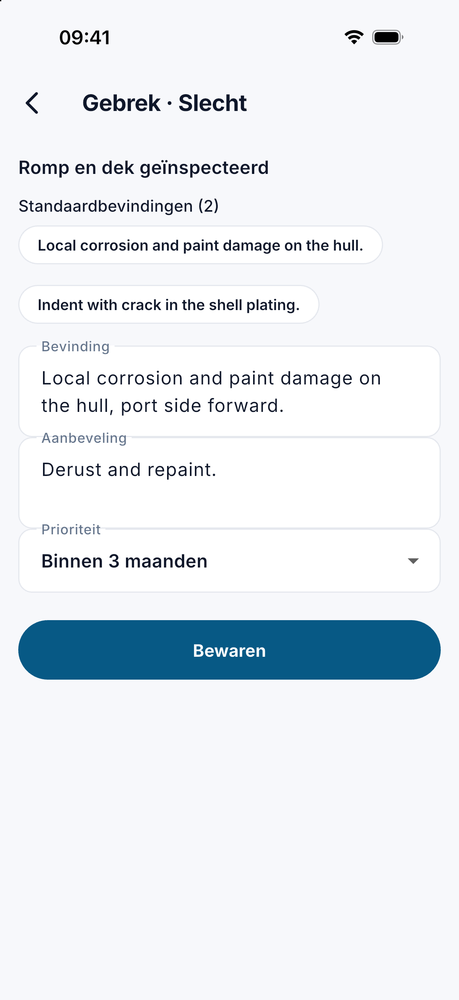

# De checklist

Heeft de soort survey een checklist, dan staat op het dossier de kaart **Checklist**, met hoeveel punten er beantwoord zijn. Tik op de kaart om de checklist te openen.

{ width="320" }

## Antwoorden

Onder elk punt staan de knoppen van de schaal. De soort survey bepaalt welke:

- bij een controle: **In orde**, **Niet in orde** en **N.v.t.**;
- bij een conditiesurvey: **Goed**, **Redelijk**, **Matig**, **Slecht** en **N.v.t.**

Een goed antwoord bewaart u met één tik. Een punt met *foto verplicht* vraagt een foto bij dat punt. Die zet kantoor erbij met **Foto's toevoegen**: in de veldapp hangt een foto altijd aan een [vaststelling](vaststellingen.md). → [Checklist](../dossiers.md#checklist)

Elk antwoord wordt **toegevoegd**: een nieuw antwoord vervangt het vorige niet, het komt erbij. Het laatste telt, op het moment waarop u het gaf, ook als het pas later aankomt. Kantoor ziet de vorige antwoorden, met wie en wanneer.

## Een gebrek

Bij **Niet in orde**, **Matig** of **Slecht** opent het scherm **Gebrek**.

{ width="320" }

1. Tik eventueel op een van de **Standaardbevindingen** van het punt: die vult de **Bevinding** en de **Aanbeveling**, in de taal van het dossier.
2. Pas de **Bevinding** en de **Aanbeveling** aan waar nodig.
3. Kies de **Prioriteit**: **Onmiddellijk, vóór vertrek**, **Binnen 3 maanden**, **Bij het volgende onderhoud** of **Ter info**.
4. Tik op **Bewaren**.

Onder het punt staan dan de prioriteit, de bevinding en de aanbeveling, in het rood. Tikt u opnieuw op een gebrek, dan begint het scherm met de tekst van het vorige gebrek.

De standaardbevindingen komen van uw bureau, per soort survey. → [Soorten survey](../soorten-survey.md)

## In het rapport

De gebreken komen in het rapport met hun prioriteit en aanbeveling. Op kantoor staat de checklist op het tabblad **Checklist** van het dossier. → [Checklist](../dossiers.md#checklist)

## Zie ook

- [Vaststellingen en foto's](vaststellingen.md)
- [Het dossier](dossier.md)
