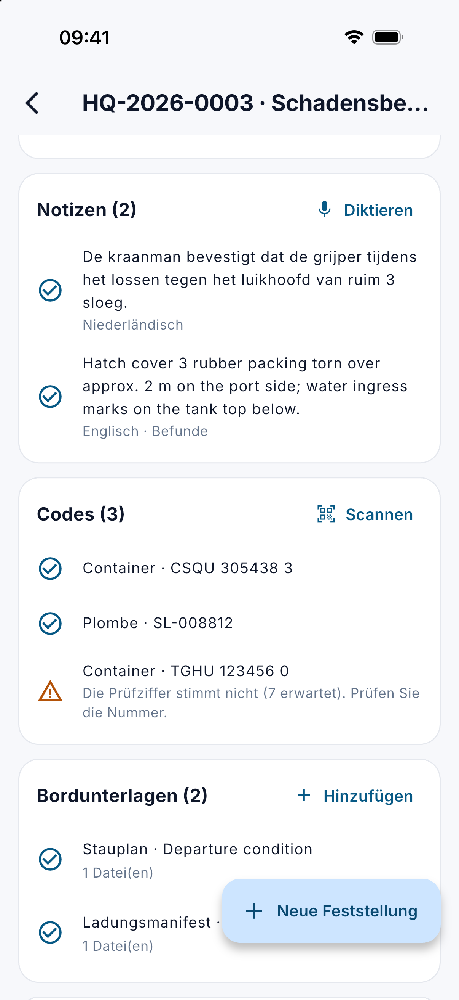

# Die Akte

Eine Akte ist in der Feld-App eine Seite mit Karten, in der Reihenfolge der Arbeit an Bord. Jede Karte hat rechts in ihrem Kopf ihre eigene Schaltfläche.

{ width="320" }

## Die Karten

| Karte | Schaltfläche | Was |
|---|---|---|
| Der Kopf | **Arbeit vor Ort beginnen** oder **Vor Ort fertig → Bericht** | Das Schiff, wann und wo, der Auftraggeber und die Beschreibung des Auftrags |
| **Arbeitsanweisung** | die Karte selbst | Nur wenn Ihr Büro eine für die Besichtigungsart geschrieben hat: siehe [Arbeitsanweisung](#arbeitsanweisung) |
| **Umstände und Anwesende** | **Ausfüllen** | Wetter, See, Sicht, Liegeplatz und wer anwesend war: siehe [An Bord erfassen](aan-boord.md#umstande-und-anwesende) |
| **Zeitablauf** | **Ereignis** | Nur bei einer Besichtigungsart mit Zeitablauf: siehe [An Bord erfassen](aan-boord.md#zeitablauf) |
| **Checkliste** | die Karte selbst | Wie viele Punkte beantwortet sind. Tippen Sie auf die Karte, um die Checkliste zu öffnen: siehe [Die Checkliste](checklist.md) |
| **Feststellungen** | **Hinzufügen** | Was Sie an Bord feststellen, mit Fotos: siehe [Feststellungen und Fotos](vaststellingen.md) |
| **Notizen** | **Diktieren** | Sprachnotizen: siehe [An Bord erfassen](aan-boord.md#sprachnotizen) |
| **Codes** | **Scannen** | Containernummern, Plomben, Proben: siehe [An Bord erfassen](aan-boord.md#codes) |
| **Bordunterlagen** | **Hinzufügen** | Stauplan, Ladungsmanifest, Logbuch, …: siehe [An Bord erfassen](aan-boord.md#bordunterlagen) |
| **Zeit** | **Uhr starten** | Ihre Zeit an dieser Akte: siehe [Zeit erfassen](tijd.md) |
| **Bunkerbesichtigung** | die Karte selbst | Nur bei einer Besichtigungsart mit Bunkerbesichtigung: siehe [An Bord erfassen](aan-boord.md#bunkerbesichtigung) |
| **Unterschriften** | **Unterschreiben** | Die Erklärung unterschreiben lassen: siehe [Unterschreiben lassen](laten-tekenen.md) |
| **Daten** | — | Die Besichtigungsdaten, wie das Büro sie ausgefüllt hat. Hier nur zum Lesen |

{ width="320" }

## Arbeitsanweisung

Hat Ihr Büro eine Arbeitsanweisung für die Besichtigungsart geschrieben, steht sie als erste Karte unter dem Kopf, in der Sprache Ihres Geräts. Die Karte zeigt den Anfang: Tippen Sie darauf, um die ganze Arbeitsanweisung zu lesen. Ohne Arbeitsanweisung gibt es keine Karte. → [Besichtigungsarten](../soorten-survey.md)

## Gesendet oder noch unterwegs

Jede Zeile auf einer Karte trägt ein Zeichen:

- ein **Häkchen**: Es ist bei Quaymark;
- eine **Wolke mit einem Pfeil** und *noch nicht gesendet*: Es ist auf Ihrem Gerät und wird gesendet, sobald eine Verbindung besteht.

Was Sie speichern, steht sofort auf der Karte, auch offline. Nach dem Speichern sagt die App *Auf dem Gerät gespeichert — wird bei Verbindung gesendet.* → [Offline](zonder-bereik.md)

## Die Arbeit beginnen und abschließen

Die Schaltfläche im Kopf folgt dem Stand der Akte:

1. Bei einer **neuen** oder **geplanten** Akte steht dort **Arbeit vor Ort beginnen**. Tippen Sie darauf, wenn Sie an Bord beginnen: Die Akte geht auf **In Bearbeitung**.
2. Dann steht dort **Vor Ort fertig → Bericht**. Tippen Sie darauf, wenn die Arbeit an Bord fertig ist: Die Akte geht auf **Berichterstellung**, und das Büro sieht, dass der Bericht an der Reihe ist.

Der Stand steht als Etikett im Kopf. Auch ein Stand geht über das Gerät: Offline wird er später gesendet, in der Reihenfolge, in der Sie getippt haben.

## Eine abgeschlossene Akte

Eine Akte, die im Büro abgeschlossen oder storniert wird, verschwindet bei der nächsten Synchronisierung aus Meine Akten. Was Sie danach noch gespeichert haben, lehnt Quaymark ab: Es steht dann rot unter **Noch zu senden**. → [Eine abgelehnte Aktion](zonder-bereik.md#eine-abgelehnte-aktion)

## Siehe auch

- [Meine Akten](mijn-dossiers.md)
- [Akten](../dossiers.md) — dieselbe Akte im Büro
