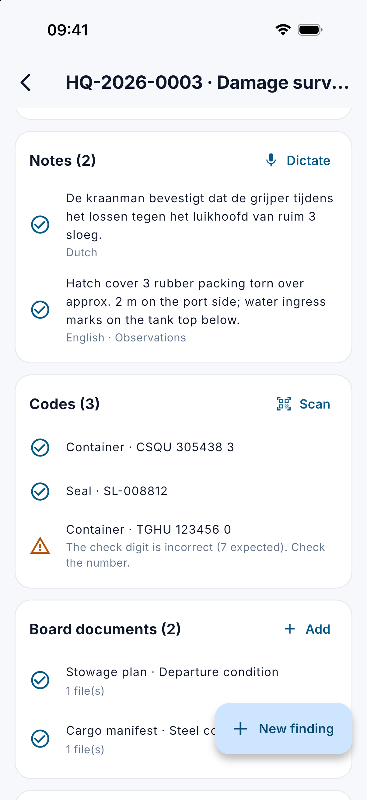

# The file

In the field app a file is one page of cards, in the order of the work on board. Each card has its own button on the right of its header.

{ width="320" }

## The cards

| Card | Button | What |
|---|---|---|
| The header | **Start on-site work** or **Done on site → reporting** | The vessel, when and where, the principal and the description of the assignment |
| **Checklist** | the card itself | How many items are answered. Tap the card to open the checklist: see [The checklist](checklist.md) |
| **Findings** | **Add** | What you find on board, with photos: see [Findings and photos](vaststellingen.md) |
| **Notes** | **Dictate** | Voice notes: see [Recording on board](aan-boord.md#voice-notes) |
| **Codes** | **Scan** | Container numbers, seals, samples: see [Recording on board](aan-boord.md#codes) |
| **Board documents** | **Add** | Stowage plan, cargo manifest, logbook, …: see [Recording on board](aan-boord.md#board-documents) |
| **Time** | **Start timer** | Your time on this file: see [Recording time](tijd.md) |
| **Bunker survey** | the card itself | Only for a survey type with bunker survey: see [Recording on board](aan-boord.md#bunker-survey) |
| **Signatures** | **Sign** | Get the statement signed: see [Getting a signature](laten-tekenen.md) |
| **Details** | — | The survey particulars, as the office filled them in. Read-only here |

You can also create a finding with the **New finding** button at the bottom of the screen.

{ width="320" }

## Sent or still on its way

Each row on a card carries a sign:

- a **tick**: it is in Quaymark;
- a **cloud with an arrow** and *not sent yet*: it is on your device and is sent as soon as there is a connection.

What you save appears on the card straight away, even offline. After saving, the app says *Saved on the device — sent when there is a connection.* → [Offline](zonder-bereik.md)

## Starting and finishing the work

The button in the header follows the stage of the file:

1. For a **new** or **scheduled** file it says **Start on-site work**. Tap it when you start on board: the file moves to **In progress**.
2. Then it says **Done on site → reporting**. Tap it when the work on board is done: the file moves to **Reporting**, and the office sees that the report is next.

The stage is shown as a label in the header. A stage also goes through the device: offline, it is sent later, in the order in which you tapped.

## A closed file

A file that is closed or cancelled at the office disappears from My files at the next sync. Whatever you still saved after that, Quaymark refuses: it then shows in red on **Still to send**. → [A refused action](zonder-bereik.md#a-refused-action)

## See also

- [My files](mijn-dossiers.md)
- [Files](../dossiers.md) — the same file at the office
