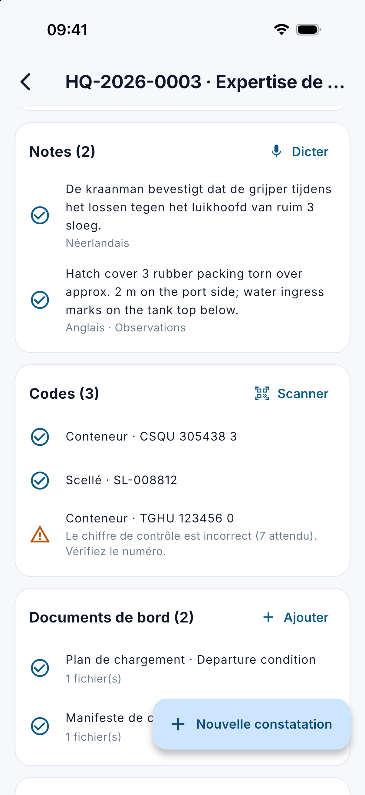

# Le dossier

Dans l'application de terrain, un dossier est une seule page avec des cartes, dans l'ordre du travail à bord. Chaque carte a son propre bouton, à droite de son en-tête.

{ width="320" }

## Les cartes

| Carte | Bouton | Quoi |
|---|---|---|
| L'en-tête | **Commencer sur place** ou **Terminé sur place → rapport** | Le navire, quand et où, le donneur d'ordre et la description de la mission |
| **Check-list** | la carte elle-même | Combien de points ont une réponse. Touchez la carte pour ouvrir la check-list : voir [La check-list](checklist.md) |
| **Constatations** | **Ajouter** | Ce que vous constatez à bord, avec photos : voir [Constatations et photos](vaststellingen.md) |
| **Notes** | **Dicter** | Notes vocales : voir [Consigner à bord](aan-boord.md#notes-vocales) |
| **Codes** | **Scanner** | Numéros de conteneur, scellés, échantillons : voir [Consigner à bord](aan-boord.md#codes) |
| **Documents de bord** | **Ajouter** | Plan de chargement, manifeste de cargaison, journal de bord, … : voir [Consigner à bord](aan-boord.md#documents-de-bord) |
| **Temps** | **Démarrer le chrono** | Votre temps sur ce dossier : voir [Enregistrer le temps](tijd.md) |
| **Expertise de soutes** | la carte elle-même | Seulement pour un type d'expertise avec expertise de soutes : voir [Consigner à bord](aan-boord.md#expertise-de-soutes) |
| **Signatures** | **Signer** | Faire signer la déclaration : voir [Faire signer](laten-tekenen.md) |
| **Données** | — | Les données de l'expertise, telles que le bureau les a remplies. Ici en lecture seule |

Vous créez aussi une constatation avec le bouton **Nouvelle constatation** en bas de l'écran.

{ width="320" }

## Envoyé ou encore en route

Chaque ligne d'une carte porte un signe :

- une **coche** : c'est chez Quaymark ;
- un **nuage avec une flèche** et *pas encore envoyé* : c'est sur votre appareil et part dès qu'il y a du réseau.

Ce que vous enregistrez apparaît aussitôt sur la carte, même hors connexion. Après l'enregistrement, l'application dit *Enregistré sur l'appareil — envoyé dès qu'il y a du réseau.* → [Hors connexion](zonder-bereik.md)

## Commencer et terminer le travail

Le bouton de l'en-tête suit l'étape du dossier :

1. Pour un dossier **nouveau** ou **planifié**, il est écrit **Commencer sur place**. Touchez-le quand vous commencez à bord : le dossier passe à **En cours**.
2. Il est alors écrit **Terminé sur place → rapport**. Touchez-le quand le travail à bord est terminé : le dossier passe à **Rapport**, et le bureau voit que c'est au tour du rapport.

L'étape figure comme étiquette dans l'en-tête. Une étape passe aussi par l'appareil : hors connexion, elle part plus tard, dans l'ordre où vous avez touché.

## Un dossier clôturé

Un dossier clôturé ou annulé au bureau disparaît de Mes dossiers à la synchronisation suivante. Ce que vous avez encore enregistré ensuite, Quaymark le refuse : cela figure alors en rouge dans **À envoyer**. → [Une action refusée](zonder-bereik.md#une-action-refusee)

## Voir aussi

- [Mes dossiers](mijn-dossiers.md)
- [Dossiers](../dossiers.md) — le même dossier au bureau
