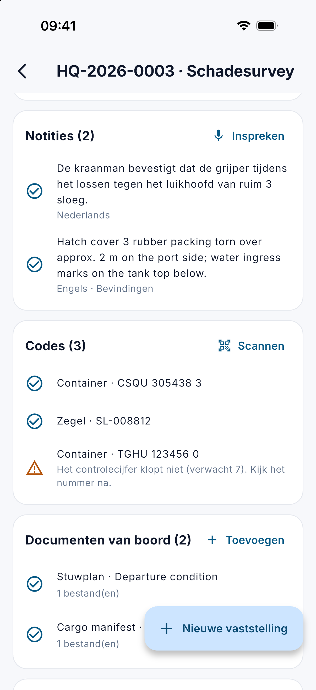

# Het dossier

Een dossier is in de veldapp één pagina met kaarten, in de volgorde van het werk aan boord. Elke kaart heeft rechts in haar kop haar eigen knop.

{ width="320" }

## De kaarten

| Kaart | Knop | Wat |
|---|---|---|
| De kop | **Werk ter plaatse starten** of **Klaar ter plaatse → rapportage** | Het schip, wanneer en waar, de opdrachtgever en de omschrijving van de opdracht |
| **Werkinstructie** | de kaart zelf | Enkel als uw bureau er een schreef bij de soort survey: zie [De werkinstructie](#de-werkinstructie) |
| **Omstandigheden en aanwezigen** | **Invullen** | Weer, zee, zicht, ligplaats en wie aanwezig was: zie [Aan boord vastleggen](aan-boord.md#omstandigheden-en-aanwezigen) |
| **Tijdlijn** | **Gebeurtenis** | Enkel bij een soort survey met een tijdlijn: zie [Aan boord vastleggen](aan-boord.md#tijdlijn) |
| **Checklist** | de kaart zelf | Hoeveel punten beantwoord zijn. Tik op de kaart om de checklist te openen: zie [De checklist](checklist.md) |
| **Vaststellingen** | **Toevoegen** | Wat u aan boord vaststelt, met foto's: zie [Vaststellingen en foto's](vaststellingen.md) |
| **Notities** | **Inspreken** | Spraaknotities: zie [Aan boord vastleggen](aan-boord.md#spraaknotities) |
| **Codes** | **Scannen** | Containernummers, zegels, stalen: zie [Aan boord vastleggen](aan-boord.md#codes) |
| **Documenten van boord** | **Toevoegen** | Stuwplan, cargo manifest, logboek, …: zie [Aan boord vastleggen](aan-boord.md#documenten-van-boord) |
| **Tijd** | **Start klok** | Uw tijd op dit dossier: zie [Tijd registreren](tijd.md) |
| **Bunker survey** | de kaart zelf | Enkel bij een soort survey met bunker survey: zie [Aan boord vastleggen](aan-boord.md#bunker-survey) |
| **Handtekeningen** | **Tekenen** | De verklaring laten tekenen: zie [Laten tekenen](laten-tekenen.md) |
| **Gegevens** | — | De gegevens van de survey, zoals kantoor ze invulde. Hier enkel te lezen |

{ width="320" }

## De werkinstructie

Schreef uw bureau een werkinstructie bij de soort survey, dan staat ze als eerste kaart onder de kop, in de taal van uw toestel. De kaart toont het begin: tik erop om de hele werkinstructie te lezen. Zonder werkinstructie is er geen kaart. → [Soorten survey](../soorten-survey.md)

## Verstuurd of nog onderweg

Elke regel op een kaart draagt een teken:

- een **vinkje**: het staat bij Quaymark;
- een **wolk met een pijl** en *nog niet verstuurd*: het staat op uw toestel en vertrekt zodra er bereik is.

Wat u bewaart, staat meteen op de kaart, ook zonder bereik. Na het bewaren zegt de app *Bewaard op het toestel — wordt verstuurd zodra er bereik is.* → [Zonder bereik](zonder-bereik.md)

## Het werk starten en afronden

De knop in de kop volgt de stap van het dossier:

1. Bij een **nieuw** of **gepland** dossier staat **Werk ter plaatse starten**. Tik erop wanneer u aan boord begint: het dossier gaat naar **In uitvoering**.
2. Dan staat er **Klaar ter plaatse → rapportage**. Tik erop wanneer het werk aan boord af is: het dossier gaat naar **Rapportage**, en kantoor ziet dat het rapport aan de beurt is.

De stap staat als label in de kop. Ook een stap gaat via het toestel: zonder bereik vertrekt hij later, in de volgorde waarin u tikte.

## Een afgesloten dossier

Een dossier dat op kantoor afgesloten of geannuleerd wordt, verdwijnt bij de volgende synchronisatie uit Mijn dossiers. Wat u daarna nog bewaarde, weigert Quaymark: het staat dan in het rood op **Nog te versturen**. → [Een geweigerde handeling](zonder-bereik.md#een-geweigerde-handeling)

## Zie ook

- [Mijn dossiers](mijn-dossiers.md)
- [Dossiers](../dossiers.md) — hetzelfde dossier op kantoor
