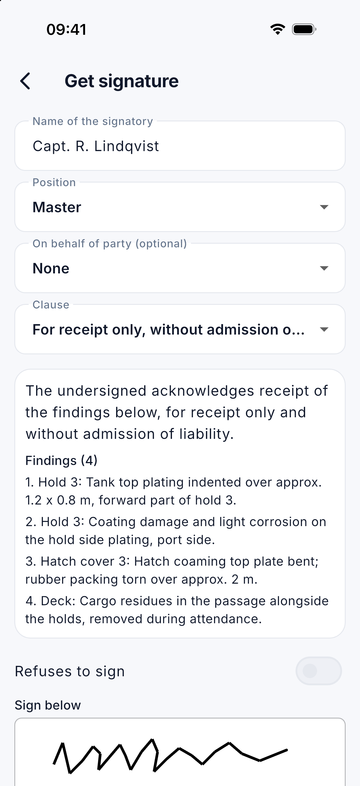

# Getting a signature

On board you have the master, the chief officer or the terminal sign a statement, with the findings of that moment. If they refuse, you record the refusal, with the reason. This also works offline.

## Getting a signature

Tap **Sign** on the **Signatures** card of the file.

{ width="320" }

1. Fill in the **Name of the signatory** and choose their **Position**.
2. If needed, choose **On behalf of party (optional)**: one of the parties of the file.
3. Choose the **Clause**. Below it is the statement, with the findings they sign.
4. Have them sign under **Sign below**. **Clear** wipes the box.
5. Tap **Save signature**.

What the signatory reads is in the **language of the file**: the statement, the heading above the findings and the locations on board. So an English-speaking master signs an English statement, even if your app is in Dutch.

As long as a finger is on the signature box, the page does not scroll.

## If they refuse to sign

1. Switch on **Refuses to sign**.
2. Fill in the **Reason for refusal**.
3. Tap **Save refusal**.

On the card the refusal is shown with a prohibition sign and the reason.

## What Quaymark keeps

A signature is only ever **added**, never changed. Quaymark keeps the statement and the list of findings at the moment of signing (the snapshot), the image of the signature with the time and, if the device knows it, the position. Without a position the signature is still sent.

A finding you add after the signature is not part of that signature. Get a new signature if needed.

Offline, the signature is sent later, after the findings it contains. At the office it is on the **Signatures** tab of the file. → [Signatures](../dossiers.md#signatures)

## Common mistakes

!!! warning "Saving fails"
    The app asks for a name, and a signature in the box. For a refusal it asks for a reason.

## See also

- [Findings and photos](vaststellingen.md)
- [Signatures](../dossiers.md#signatures) — at the office
