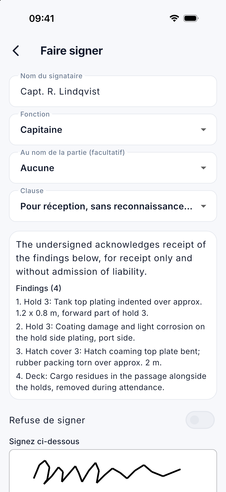

# Faire signer

À bord, vous faites signer une déclaration au capitaine, au second ou au terminal, avec les constatations de ce moment. S'il refuse, vous enregistrez le refus, avec le motif. Cela fonctionne aussi hors connexion.

## Faire signer

Touchez **Signer** sur la carte **Signatures** du dossier.

{ width="320" }

1. Indiquez le **Nom du signataire** et choisissez sa **Fonction**.
2. Choisissez éventuellement la partie **Au nom de la partie (facultatif)** : l'une des parties du dossier.
3. Choisissez la **Clause**. En dessous figure la déclaration, avec les constatations qu'il signe.
4. Faites signer sous **Signez ci-dessous**. **Recommencer** efface le cadre.
5. Touchez **Enregistrer la signature**.

Ce que lit le signataire est dans la **langue du dossier** : la déclaration, le titre au-dessus des constatations et les emplacements à bord. Un capitaine anglais signe ainsi une déclaration en anglais, même si votre application est en français.

Tant qu'un doigt est posé sur le cadre, la page ne défile pas.

## S'il refuse de signer

1. Activez **Refuse de signer**.
2. Indiquez le **Motif du refus**.
3. Touchez **Enregistrer le refus**.

Sur la carte, le refus figure avec un signe d'interdiction et le motif.

## Ce que Quaymark conserve

Une signature est seulement **ajoutée**, jamais modifiée. Quaymark conserve la déclaration et la liste des constatations du moment de la signature (l'instantané), l'image de la signature avec l'heure et, si l'appareil la connaît, la position. Sans position, la signature part quand même.

Une constatation ajoutée après la signature ne figure pas dans cette signature. Faites signer à nouveau si nécessaire.

Hors connexion, la signature part plus tard, après les constatations qu'elle contient. Au bureau, elle figure dans l'onglet **Signatures** du dossier. → [Signatures](../dossiers.md#signatures)

## Erreurs fréquentes

!!! warning "L'enregistrement échoue"
    L'application demande un nom, et une signature dans le cadre. Pour un refus, elle demande un motif.

## Voir aussi

- [Constatations et photos](vaststellingen.md)
- [Signatures](../dossiers.md#signatures) — au bureau
