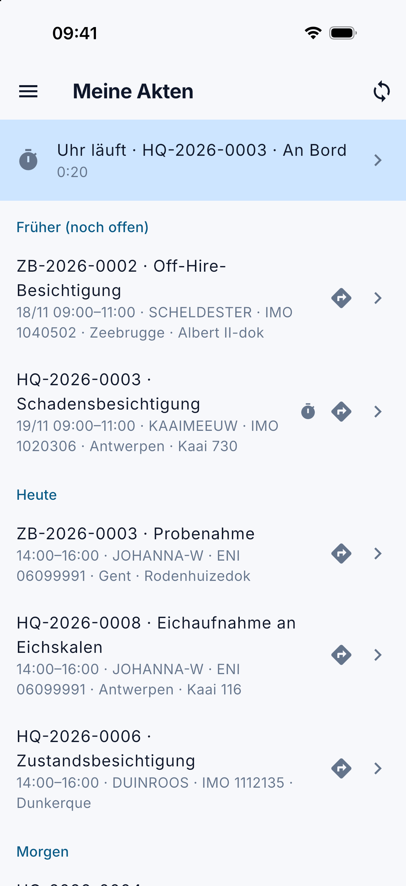
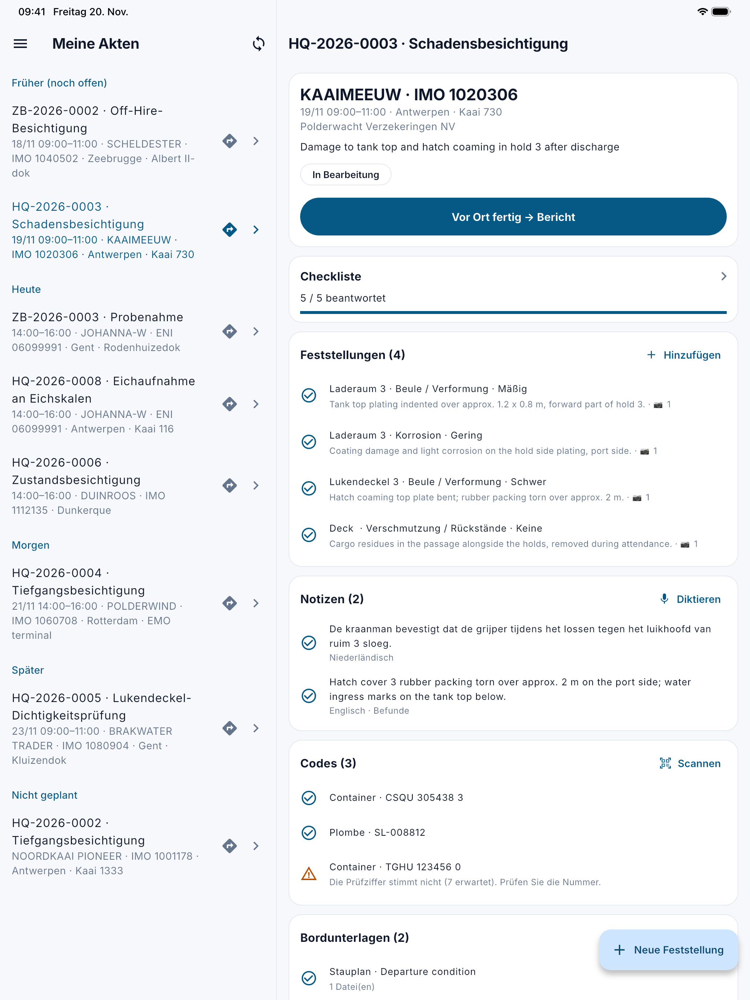

# Meine Akten

Der erste Bildschirm der Feld-App: die offenen Akten, deren Sachverständiger Sie sind, nach Tag. Die Liste steht auf dem Gerät, sie funktioniert also auch offline.

{ width="320" }

## Die Liste

Die Akten stehen in Gruppen, nach dem Zeitpunkt, zu dem sie geplant sind:

- **Früher (noch offen)**: vor heute geplant und noch nicht abgeschlossen;
- **Heute**, **Morgen**, **Diese Woche** (bis einschließlich Sonntag) und **Später**;
- **Nicht geplant**: zugewiesen, aber noch ohne Zeitpunkt.

Jede Zeile zeigt die Nummer und die Besichtigungsart, darunter den Zeitpunkt, das Schiff, den Hafen und das Terminal. Der Zeitpunkt steht in der Zeit der Niederlassung der Akte, nicht in der Ihres Telefons. Eine Akte an einem anderen Tag trägt auch ihr Datum.

Tippen Sie auf eine Akte, um sie zu öffnen. → [Die Akte](dossier.md)

## Navigieren

Kennt die Akte einen Hafen oder ein Terminal, steht rechts eine Schaltfläche mit einem Wegweiser: **Navigieren**. Sie öffnet die Karten-App Ihres Geräts (Apple Karten oder Google Maps) mit dem Terminal und dem Hafen als Suche.

## Die laufende Uhr

Läuft Ihre Uhr, steht oben in der Liste ein Balken mit **Uhr läuft**, der Akte, der Art der Arbeit und wie lange sie schon läuft. Tippen Sie darauf, um die Akte zu öffnen. Bei dieser Akte steht auch ein kleines Uhrsymbol. → [Zeit erfassen](tijd.md)

## Synchronisieren

Die App ruft den aktuellen Stand ab und sendet, was wartet:

- wenn Meine Akten sich öffnet, und jedes Mal, wenn Sie zur App zurückkehren;
- mit der Schaltfläche mit den zwei Pfeilen oben rechts (**Synchronisieren**) oder indem Sie die Liste nach unten ziehen.

Bei jeder Runde ruft die App auch jede Akte der Liste vollständig ab, damit Sie sie später offline öffnen können.

Oben in der Liste kann eine Meldung stehen:

| Meldung | Was sie bedeutet |
|---|---|
| *Offline — zuletzt abgerufener Stand* | Es gibt keine Verbindung. Sie sehen die Liste vom letzten Mal; Ihre Arbeit wartet auf dem Gerät |
| **… wartend** (oben rechts) | So viele Aktionen oder Fotos warten noch. Tippen Sie darauf für die Liste **Noch zu senden** |
| *… abgelehnt — zum Prüfen tippen* (rot) | Quaymark hat etwas abgelehnt. Tippen Sie darauf, um zu sehen, was und warum |
| *Noch nichts abgerufen* | Sie haben sich ohne Verbindung angemeldet. Sobald eine besteht, kommen Ihre Akten |

→ [Offline](zonder-bereik.md)

## Auf einem Tablet

Auf einem Tablet stehen Liste und Akte nebeneinander: links die Liste, rechts die gewählte Akte. Solange Sie nichts gewählt haben, steht rechts *Wählen Sie links eine Akte.*

{ width="560" }

## Häufige Fehler

!!! warning "Eine Akte fehlt"
    Die Liste zeigt nur offene Akten, deren Sachverständiger Sie sind. Wurde die Akte gerade erst zugewiesen, tippen Sie auf **Synchronisieren**. Steht sie immer noch nicht da, prüfen Sie im Büro, ob Sie der Sachverständige sind und ob die Akte nicht abgeschlossen oder storniert ist.

!!! warning "Die Uhrzeit stimmt nicht mit meinem Telefon überein"
    Die App zeigt die Uhrzeit der Niederlassung der Akte, nicht die Ihres Telefons. So steht es auch in der Planung im Büro.

## Siehe auch

- [Die Akte](dossier.md)
- [Planung](../planning.md) — wie das Büro Akten plant und zuweist
