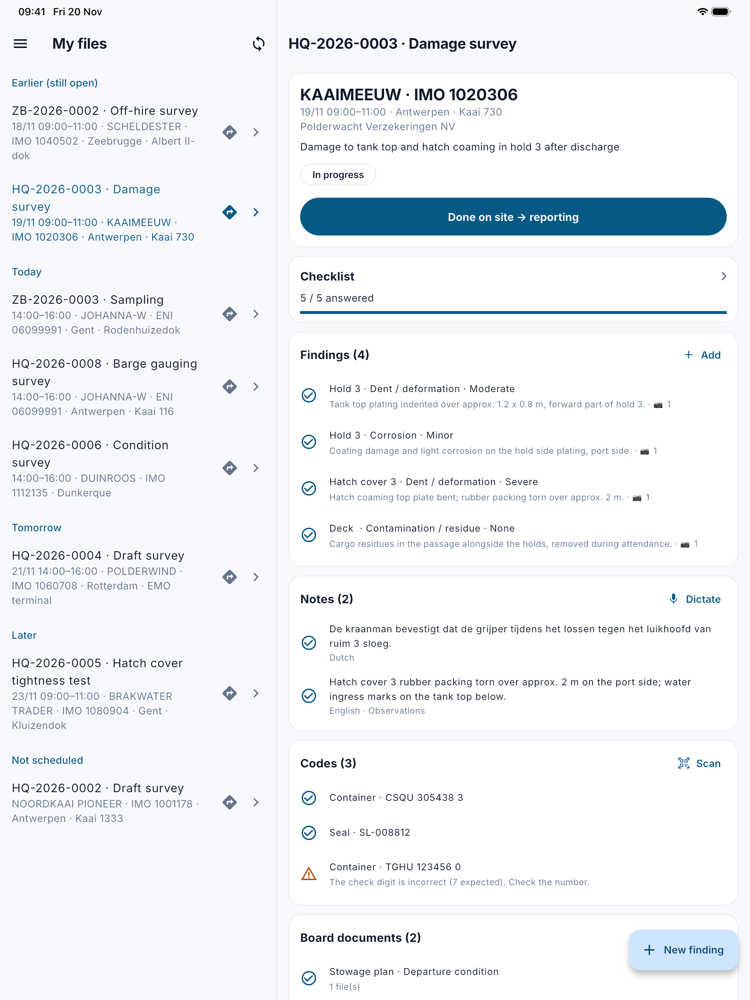

# My files

The first screen of the field app: the open files of which you are the surveyor, by day. The list is on the device, so it also works offline.

{ width="320" }

## The list

The files are grouped by when they are scheduled:

- **Earlier (still open)**: scheduled before today and not closed yet;
- **Today**, **Tomorrow**, **This week** (up to and including Sunday) and **Later**;
- **Not scheduled**: assigned, but without a time yet.

Each row shows the number and the survey type, and below it the time, the vessel, the port and the terminal. The time is in the time zone of the file's branch, not that of your phone. A file on another day also shows its date.

Tap a file to open it. → [The file](dossier.md)

## Navigating

If the file has a port or a terminal, there is a button with a signpost on the right: **Navigate**. It opens the maps app of your device (Apple Maps or Google Maps) with the terminal and the port as the search.

## The running timer

If your timer is running, a bar at the top of the list shows **Timer running**, the file, the type of work and how long it has been running. Tap it to open the file. That file also shows a small clock. → [Recording time](tijd.md)

## Syncing

The app fetches the latest state and sends what is waiting:

- when My files opens, and every time you return to the app;
- with the button with two arrows at the top right (**Sync**), or by pulling the list down.

In every round the app also fetches each file in the list in full, so that you can open it offline later.

A message may appear at the top of the list:

| Message | What it means |
|---|---|
| *Offline — last fetched state* | There is no connection. You see the list from last time; your work waits on the device |
| **… pending** (top right) | That many actions or photos are still waiting. Tap it for the list **Still to send** |
| *… refused — tap to review* (red) | Quaymark refused something. Tap to see what and why |
| *Nothing fetched yet* | You signed in without a connection. As soon as there is one, your files arrive |

→ [Offline](zonder-bereik.md)

## On a tablet

On a tablet the list and the file are side by side: the list on the left, the file you chose on the right. Until you choose one, the right side says *Choose a file on the left.*

{ width="560" }

## Common mistakes

!!! warning "A file is missing"
    The list only shows open files of which you are the surveyor. If the file was only just assigned, tap **Sync**. If it still does not appear, check at the office that you are the surveyor and that the file is not closed or cancelled.

!!! warning "The time does not match my phone"
    The app shows the time in the time zone of the file's branch, not that of your phone. The schedule at the office does the same.

## See also

- [The file](dossier.md)
- [Schedule](../planning.md) — how the office schedules and assigns files
