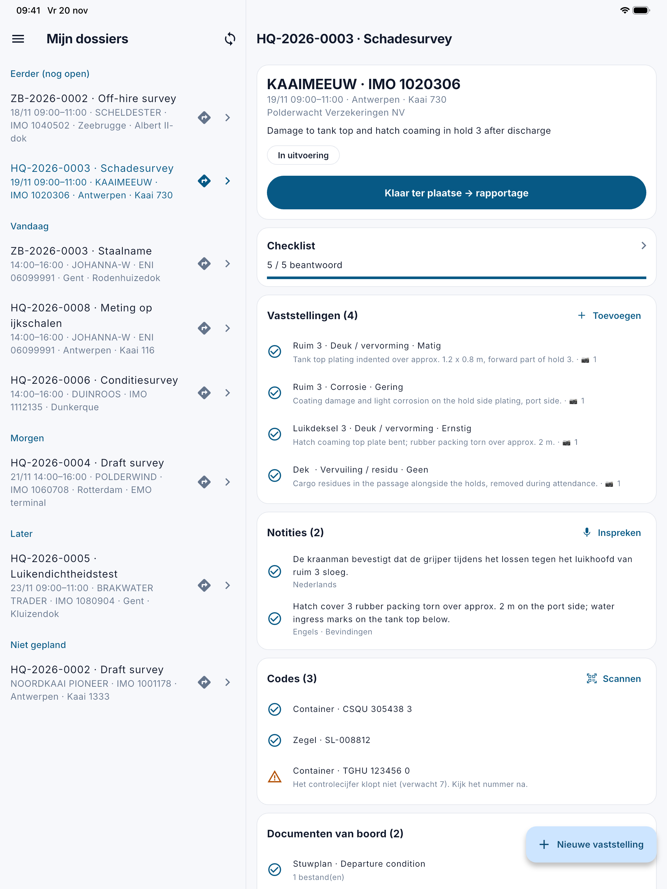

# Mijn dossiers

Het eerste scherm van de veldapp: de open dossiers waarvan u de surveyor bent, per dag. De lijst staat op het toestel, dus ze werkt ook zonder bereik.

{ width="320" }

## De lijst

De dossiers staan in groepen, op het tijdstip waarop ze gepland zijn:

- **Eerder (nog open)**: gepland vóór vandaag en nog niet afgesloten;
- **Vandaag**, **Morgen**, **Deze week** (tot en met zondag) en **Later**;
- **Niet gepland**: toegewezen, maar nog zonder tijdstip.

Elke regel toont het nummer en de soort survey, en daaronder het tijdstip, het schip, de haven en de terminal. Het tijdstip staat in de tijd van de vestiging van het dossier, niet in die van uw telefoon. Een dossier van een andere dag draagt ook zijn datum.

Tik op een dossier om het te openen. → [Het dossier](dossier.md)

## Navigeren

Kent het dossier een haven of een terminal, dan staat er rechts een knop met een wegwijzer: **Navigeer**. Die opent de kaarten-app van uw toestel (Apple Kaarten of Google Maps) met de terminal en de haven als zoekopdracht.

## De lopende klok

Loopt uw klok, dan staat bovenaan de lijst een balk met **Klok loopt**, het dossier, de soort werk en hoe lang ze al loopt. Tik erop om het dossier te openen. Bij dat dossier staat ook een klokje. → [Tijd registreren](tijd.md)

## Synchroniseren

De app haalt de verse stand op en verstuurt wat wacht:

- wanneer Mijn dossiers opent, en telkens u terugkeert naar de app;
- met de knop met de twee pijlen rechtsboven (**Synchroniseren**), of door de lijst naar beneden te trekken.

Bij elke ronde haalt de app ook elk dossier uit de lijst volledig op, zodat u het later zonder bereik kunt openen.

Bovenaan de lijst kan een melding staan:

| Melding | Wat het betekent |
|---|---|
| *Zonder bereik — laatst opgehaalde stand* | Er is geen verbinding. U ziet de lijst van de laatste keer; uw werk wacht op het toestel |
| **… wachtend** (rechtsboven) | Zoveel handelingen of foto's wachten nog. Tik erop voor de lijst **Nog te versturen** |
| *… geweigerd — tik om na te kijken* (rood) | Quaymark weigerde iets. Tik erop om te zien wat en waarom |
| *Nog niets opgehaald* | U meldde u aan zonder bereik. Zodra er bereik is, komen uw dossiers |

→ [Zonder bereik](zonder-bereik.md)

## Op een tablet

Op een tablet staan de lijst en het dossier naast elkaar: links de lijst, rechts het dossier dat u koos. Zolang u niets koos, staat rechts *Kies links een dossier.*

{ width="560" }

## Veelgemaakte fouten

!!! warning "Een dossier ontbreekt"
    De lijst toont enkel open dossiers waarvan u de surveyor bent. Werd het dossier pas toegewezen, tik dan op **Synchroniseren**. Staat het er nog niet, kijk dan op kantoor na of u de surveyor bent, en of het dossier niet afgesloten of geannuleerd is.

!!! warning "Het uur klopt niet met mijn telefoon"
    De app toont het uur in de tijd van de vestiging van het dossier, niet in die van uw telefoon. Zo staat het ook in de planning op kantoor.

## Zie ook

- [Het dossier](dossier.md)
- [Planning](../planning.md) — hoe kantoor dossiers inplant en toewijst
