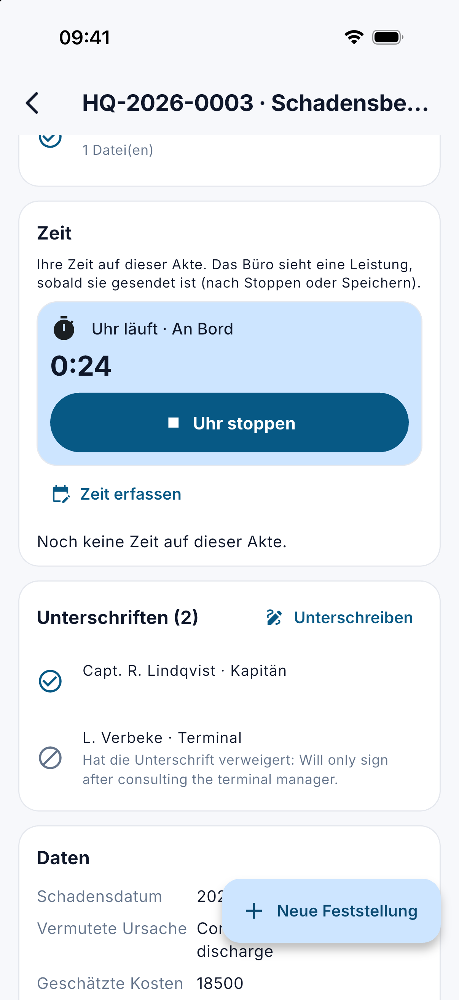
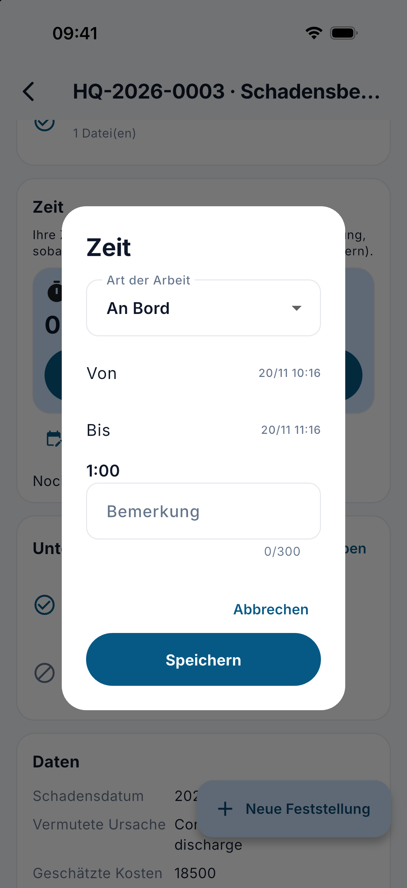

# Zeit erfassen

Auf der Karte **Zeit** einer Akte erfassen Sie Ihre Zeit: mit der Uhr oder von Hand. Das Büro sieht eine Leistung, sobald sie gesendet ist, in der Registerkarte **Zeit und Kosten** der Akte.

## Mit der Uhr

1. Tippen Sie auf **Uhr starten** auf der Karte **Zeit**.
2. Wählen Sie die **Art der Arbeit**: **An Bord**, **Reisezeit**, **Wartezeit** oder **Berichterstellung**.
3. Auf der Karte steht jetzt **Uhr läuft**, mit der Zeit. Tippen Sie auf **Uhr stoppen**, wenn Sie fertig sind.
4. Prüfen Sie **Von** und **Bis**, geben Sie bei Bedarf eine **Bemerkung** ein und tippen Sie auf **Speichern**.

{ width="320" }

{ width="320" }

Die Uhr läuft weiter, wenn Sie die App schließen: Das Gerät merkt sich, wann Sie gestartet haben. Es läuft **immer nur eine Uhr**. Läuft sie an einer anderen Akte, sagt die Karte *Die Uhr läuft bereits auf …*: Stoppen Sie diese zuerst. Die laufende Uhr steht auch oben in [Meine Akten](mijn-dossiers.md#die-laufende-uhr).

Lief die Uhr mehr als 12 Stunden, bittet die App zuerst zu prüfen, ob Sie vergessen haben, sie zu stoppen.

## Von Hand

Tippen Sie auf **Zeit erfassen** auf der Karte **Zeit**. Wählen Sie **Art der Arbeit**, **Von** und **Bis**, geben Sie bei Bedarf eine **Bemerkung** ein und tippen Sie auf **Speichern**. Das Ende liegt nach dem Beginn, innerhalb von 24 Stunden.

## Was das Büro sieht

Die Zeit wird auf die Minute gespeichert. Die Karte zeigt Ihre Zeit an dieser Akte, mit der Art der Arbeit und der Bemerkung. Das Büro sieht eine Leistung erst nach **Uhr stoppen** oder **Speichern**, sobald sie gesendet ist. Dort kann das Büro sie noch anpassen, solange sie auf keiner Rechnung und keiner Abrechnung steht. → [Zeit und Kosten](../dossiers.md#zeit-und-kosten)

Sind Sie Freiberufler, sehen Sie Ihre Zeit auch in der Web-App, unter **Meine Arbeit**. → [Meine Arbeit](../mijn-werk.md)

## Siehe auch

- [Die Akte](dossier.md)
- [Meine Akten](mijn-dossiers.md)
