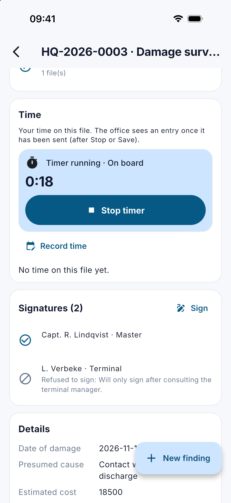
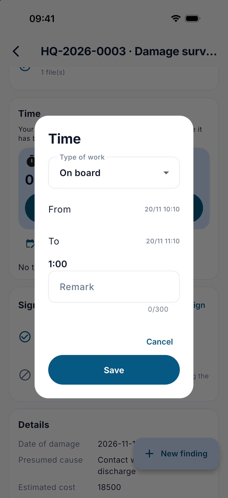

# Recording time

On the **Time** card of a file you record your time: with the timer, or by hand. The office sees an entry once it has been sent, on the **Time and expenses** tab of the file.

## With the timer

1. Tap **Start timer** on the **Time** card.
2. Choose the **Type of work**: **On board**, **Travel time**, **Waiting time** or **Reporting**.
3. The card now shows **Timer running**, with the time. Tap **Stop timer** when you are done.
4. Check **From** and **To**, fill in a **Remark** if you like, and tap **Save**.

{ width="320" }

{ width="320" }

The timer keeps running if you close the app: the device remembers when you started. Only **one timer runs at a time**. If it is running on another file, the card says *The timer is already running on …*: stop that one first. The running timer is also shown at the top of [My files](mijn-dossiers.md#the-running-timer).

If the timer ran for more than 12 hours, the app first asks you to check whether you forgot to stop it.

## By hand

Tap **Record time** on the **Time** card. Choose the **Type of work**, **From** and **To**, fill in a **Remark** if you like, and tap **Save**. The end is after the start, within 24 hours.

## What the office sees

Time is saved to the minute. The card shows your time on this file, with the type of work and the remark. The office only sees an entry after **Stop timer** or **Save**, once it has been sent. It can still adjust it there as long as it is not on an invoice or a statement. → [Time and expenses](../dossiers.md#time-and-expenses)

If you are a freelancer, you also see your time in the web app, on **My work**. → [My work](../mijn-werk.md)

## See also

- [The file](dossier.md)
- [My files](mijn-dossiers.md)
