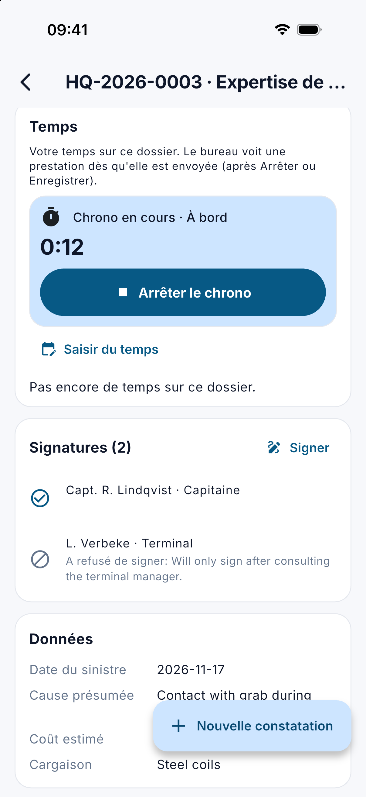
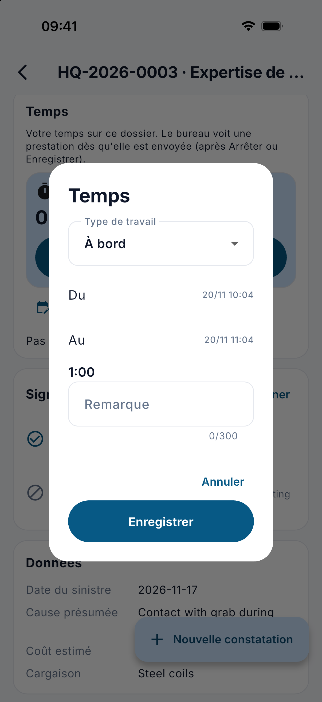

# Enregistrer le temps

Sur la carte **Temps** d'un dossier, vous enregistrez votre temps : avec le chrono, ou à la main. Le bureau voit une prestation dès qu'elle est envoyée, dans l'onglet **Temps et frais** du dossier.

## Avec le chrono

1. Touchez **Démarrer le chrono** sur la carte **Temps**.
2. Choisissez le **Type de travail** : **À bord**, **Temps de trajet**, **Temps d'attente** ou **Rapport**.
3. La carte affiche maintenant **Chrono en cours**, avec le temps écoulé. Touchez **Arrêter le chrono** quand vous avez terminé.
4. Vérifiez **Du** et **Au**, indiquez éventuellement une **Remarque** et touchez **Enregistrer**.

{ width="320" }

{ width="320" }

Le chrono continue de tourner si vous fermez l'application : l'appareil retient quand vous l'avez démarré. Un **seul chrono à la fois** tourne. S'il tourne sur un autre dossier, la carte dit *Le chrono tourne déjà sur …* : arrêtez-le d'abord. Le chrono en cours figure aussi en haut de [Mes dossiers](mijn-dossiers.md#le-chrono-en-cours).

Si le chrono a tourné plus de 12 heures, l'application demande d'abord de vérifier si vous avez oublié de l'arrêter.

## À la main

Touchez **Saisir du temps** sur la carte **Temps**. Choisissez le **Type de travail**, **Du** et **Au**, indiquez éventuellement une **Remarque** et touchez **Enregistrer**. La fin est après le début, dans les 24 heures.

## Ce que voit le bureau

Le temps est enregistré à la minute. La carte affiche votre temps sur ce dossier, avec le type de travail et la remarque. Le bureau ne voit une prestation qu'après **Arrêter le chrono** ou **Enregistrer**, et dès qu'elle est envoyée. Il peut encore l'y adapter tant qu'elle ne figure sur aucune facture ni aucun décompte. → [Temps et frais](../dossiers.md#temps-et-frais)

Si vous êtes freelance, vous voyez aussi votre temps dans l'application web, sur **Mon travail**. → [Mon travail](../mijn-werk.md)

## Voir aussi

- [Le dossier](dossier.md)
- [Mes dossiers](mijn-dossiers.md)
