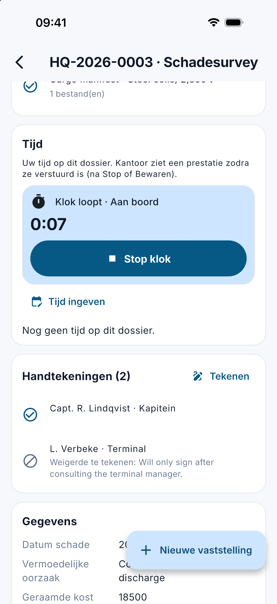
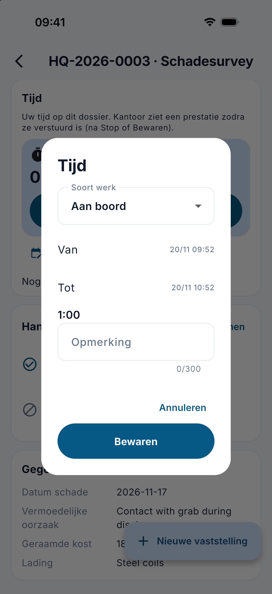

# Tijd registreren

Op de kaart **Tijd** van een dossier registreert u uw tijd: met de klok, of met de hand. Kantoor ziet een prestatie zodra ze verstuurd is, op het tabblad **Tijd en kosten** van het dossier.

## Met de klok

1. Tik op **Start klok** op de kaart **Tijd**.
2. Kies de **Soort werk**: **Aan boord**, **Reistijd**, **Wachttijd** of **Rapportering**.
3. Op de kaart staat nu **Klok loopt**, met de tijd. Tik op **Stop klok** wanneer u klaar bent.
4. Kijk **Van** en **Tot** na, vul eventueel een **Opmerking** in en tik op **Bewaren**.

{ width="320" }

{ width="320" }

De klok loopt door als u de app sluit: het toestel onthoudt wanneer u startte. Er loopt **één klok tegelijk**. Loopt ze op een ander dossier, dan zegt de kaart *De klok loopt al op …*: stop die eerst. Bovenaan [Mijn dossiers](mijn-dossiers.md#de-lopende-klok) staat de lopende klok ook.

Liep de klok meer dan 12 uur, dan vraagt de app eerst na te kijken of u vergat te stoppen.

## Met de hand

Tik op **Tijd ingeven** op de kaart **Tijd**. Kies de **Soort werk**, **Van** en **Tot**, vul eventueel een **Opmerking** in en tik op **Bewaren**. Het einde ligt na het begin, binnen 24 uur.

## Wat kantoor ziet

De tijd wordt op de minuut bewaard. Op de kaart staat uw tijd op dit dossier, met de soort werk en de opmerking. Kantoor ziet een prestatie pas na **Stop klok** of **Bewaren**, en zodra ze verstuurd is. Daar kan kantoor ze nog aanpassen, zolang ze op geen factuur of afrekening staat. → [Tijd en kosten](../dossiers.md#tijd-en-kosten)

Bent u freelancer, dan ziet u uw tijd ook in de webapp, op **Mijn werk**. → [Mijn werk](../mijn-werk.md)

## Zie ook

- [Het dossier](dossier.md)
- [Mijn dossiers](mijn-dossiers.md)
