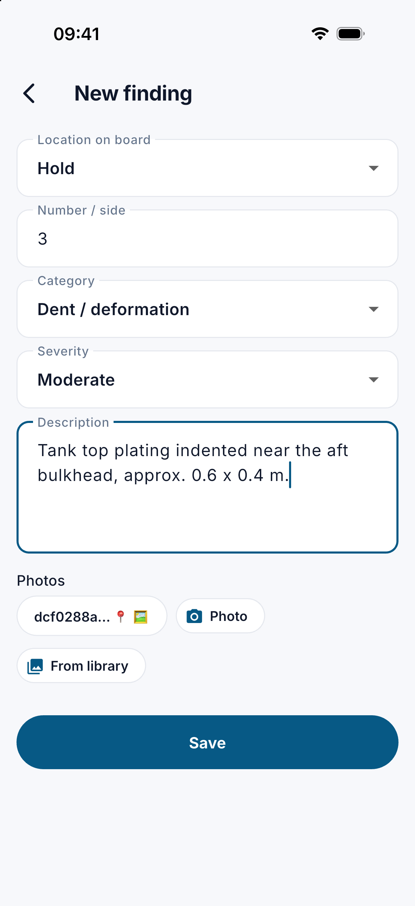

# Findings and photos

A **finding** is what you see on board: a dent in the tank top of hold 3, wet cargo, a damaged hatch seal. With its photos it is the evidence in the report.

## Adding a finding

Tap **New finding** at the bottom of the file, or **Add** on the **Findings** card.

{ width="320" }

1. Choose the **Location on board** and, if needed, fill in the **Number / side**, for example *3* or *SB*.
2. Choose the **Category** and the **Severity**: **None**, **Minor**, **Moderate** or **Severe**.
3. Describe what you see in **Description**.
4. Add photos under **Photos**: **Photo** opens the camera, **From library** picks a photo that is already on the device.
5. Tap **Save**.

Location, category and description are required. The choices of location and category come from your firm. → [Categories and locations](../categorieen-en-plaatsen.md)

The finding appears on the card straight away, with a cloud as long as it has not been sent. The photos are sent after their finding.

## What the device records with a photo

At the moment you take the photo, the app records:

- the **time**, first, even before the position;
- the **GPS position** and how accurate it is. If there is no position (no permission, no reception in a hold), the app records why;
- the **fingerprint** (SHA-256) of the photo.

Next to each photo the screen shows the first characters of the fingerprint, with 📍 if there is a position, and 🖼 for a photo from the library. The photo stays unchanged: the app does not shrink or edit anything. Quaymark recalculates the fingerprint when the photo arrives. If the photo was changed on the device in the meantime, it is not sent.

A photo **From library** carries that mark: the office can see that it was not taken with the app's camera. For evidence, preferably take the photo with **Photo**.

Once the photo has been sent and Quaymark has recalculated its fingerprint, the app deletes its copy from the device. The original is then with the firm.

## Correcting a finding

A finding is only ever **added**, never changed or deleted: that way it remains clear what was recorded on board. You therefore cannot change it in the app. You correct a mistake at the office with **Correct**, with a reason; the old version stays visible, struck through. → [Findings](../dossiers.md#findings)

If you spot the mistake before it is sent, you can discard the finding on **Still to send**. Its photos go with it. → [Offline](zonder-bereik.md)

## Common mistakes

!!! warning "No camera on this device"
    If the app finds no camera, it says so and opens the library. Then use a photo you took with the device.

!!! warning "A photo without a position"
    Allow the app to use your location (in the device settings). Deep in a hold there is sometimes no GPS reception: the photo is then sent without a position, with the reason.

## See also

- [The checklist](checklist.md)
- [Getting a signature](laten-tekenen.md) — getting the findings signed
- [Findings](../dossiers.md#findings) — at the office
