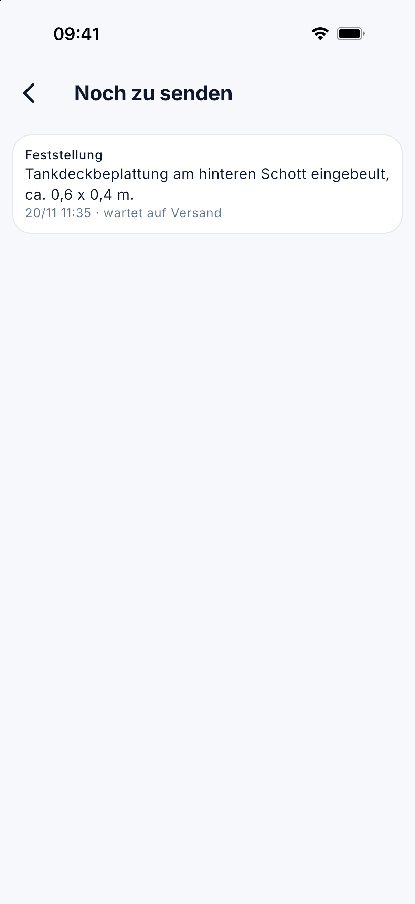

# Offline

An Bord fällt die Verbindung oft weg: im Laderaum, im Maschinenraum, vor Anker. Die Feld-App arbeitet dann weiter. Was Sie tun, speichert sie zuerst auf dem Gerät. Sobald wieder eine Verbindung besteht, geht es an Quaymark.

## Was Sie offline sehen

Bei jeder Synchronisierung ruft die App Ihre offenen Akten vollständig ab. Offline sehen Sie den Stand vom letzten Mal, mit *Offline — zuletzt abgerufener Stand* oben in Meine Akten.

Synchronisieren Sie also, bevor Sie an Bord gehen, solange Sie noch Verbindung haben. → [Synchronisieren](mijn-dossiers.md#synchronisieren)

## Was Sie offline tun können

Alles, was Sie an Bord erfassen:

- [Feststellungen](vaststellingen.md) mit Fotos;
- die [Checkliste](checklist.md) beantworten;
- [unterschreiben lassen](laten-tekenen.md);
- [Sprachnotizen, Codes, Bordunterlagen und Peilungen](aan-boord.md);
- [Zeit erfassen](tijd.md);
- die Arbeit beginnen und abschließen.

Nach dem Speichern sagt die App *Auf dem Gerät gespeichert — wird bei Verbindung gesendet.* Auf der Karte steht eine Wolke, mit *noch nicht gesendet*.

## Wann es gesendet wird

Die App sendet bei jeder Synchronisierung: wenn Meine Akten sich öffnet, wenn Sie zur App zurückkehren, und mit **Synchronisieren**. Sie sendet in der Reihenfolge, in der Sie gearbeitet haben: zuerst eine Feststellung, dann ihre Fotos und die Unterschrift, in der sie steht. Ein Foto wird in Stücken gesendet: Bricht die Verbindung mittendrin ab, macht der nächste Versuch dort weiter, wo er aufgehört hat.

Was gesendet ist, bekommt ein Häkchen.

## Noch zu senden

Wartet etwas, steht oben rechts in Meine Akten **… wartend**, und im Menü steht **Noch zu senden** mit der Anzahl. Tippen Sie darauf für die Liste: pro Aktion, was es ist und wann Sie es getan haben, mit *wartet auf Versand*. Steht dort **Alles wurde gesendet.**, hat Quaymark alles.

{ width="320" }

### Eine abgelehnte Aktion

Manchmal lehnt Quaymark etwas ab, zum Beispiel weil die Akte inzwischen abgeschlossen wurde. Oben in Meine Akten steht dann rot *… abgelehnt — zum Prüfen tippen*. Unter **Noch zu senden** steht die Aktion rot, mit **Vom Server abgelehnt** und dem Grund.

- **Erneut versuchen**: sendet sie sofort noch einmal. Sinnvoll, wenn die Ursache inzwischen behoben ist.
- **Verwerfen**: Die Aktion wird nie gesendet. Die App fragt zuerst. Bei einer Feststellung gehen ihre Fotos mit.

Eine abgelehnte Aktion hält die folgenden derselben Akte zurück. Prüfen Sie sie also sofort.

Auch ein **Foto** kann abgelehnt werden, zum Beispiel wenn es nach der Aufnahme auf dem Gerät verändert wurde. Es steht dort mit dem Anfang seines Fingerabdrucks und dem Grund, mit denselben zwei Schaltflächen.

### Zu alt zum Senden

Eine Aktion, die mehr als 30 Tage wartet, wird nicht mehr gesendet. Prüfen Sie, ob sie im Büro schon vorliegt. Wenn nicht, erfassen Sie sie neu und verwerfen Sie die alte Aktion.

### Unlesbare Aktion

Ganz selten ist eine Aktion auf dem Gerät beschädigt. Sie bleibt in der Liste, bis Sie sie verwerfen. Sagen Sie dem Büro, was Sie an diesem Tag getan haben, damit es das ergänzt.

## Abmelden, während etwas wartet

Melden Sie sich ab, während noch etwas wartet, sagt die App, wie viel. Es bleibt auf dem Gerät und wird gesendet, sobald Sie sich wieder anmelden. Ein Kollege, der sich auf demselben Gerät anmeldet, sendet es nicht. → [Abmelden](aan-de-slag.md#abmelden)

## Häufige Fehler

!!! warning "Eine Akte öffnet sich offline nicht"
    Die App zeigt nur, was sie schon einmal abgerufen hat. Wurde die Akte zugewiesen, als Sie schon an Bord waren, ist sie noch nicht auf Ihrem Gerät. Synchronisieren Sie, sobald Sie Verbindung haben.

!!! warning "Arbeit, die nicht im Büro ankommt"
    Schauen Sie unter **Noch zu senden**. Steht sie noch dort, wartet sie auf Verbindung oder wurde abgelehnt. Steht dort **Alles wurde gesendet.**, hat Quaymark sie.

## Siehe auch

- [Meine Akten](mijn-dossiers.md)
- [Die Akte](dossier.md)
