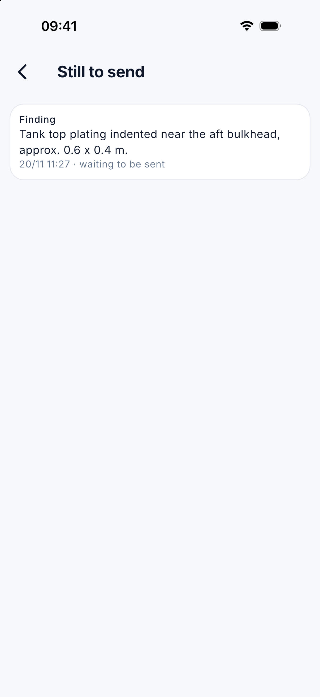

# Offline

On board the connection often drops: in a hold, in an engine room, at anchor. The field app keeps working. What you do, it saves on the device first. As soon as there is a connection again, it goes to Quaymark.

## What you see offline

At every sync the app fetches your open files in full. Offline you see the state of the last time, with *Offline — last fetched state* at the top of My files.

So sync before you go on board, while you still have a connection. → [Syncing](mijn-dossiers.md#syncing)

## What you can do offline

Everything you record on board:

- [findings](vaststellingen.md) with photos;
- answering the [checklist](checklist.md);
- [getting a signature](laten-tekenen.md);
- [the conditions and the attendance](aan-boord.md#conditions-and-attendance) and [events on the timeline](aan-boord.md#timeline);
- [voice notes, codes, board documents and soundings](aan-boord.md);
- [recording time](tijd.md);
- starting and finishing the work.

After saving, the app says *Saved on the device — sent when there is a connection.* The card shows a cloud, with *not sent yet*.

## When it is sent

The app sends at every sync: when My files opens, when you return to the app, and with **Sync**. It sends in the order you worked in: first a finding, then its photos and the signature that contains it. A photo is sent in pieces: if the connection drops halfway, the next attempt carries on where it stopped.

What has been sent gets a tick.

## Still to send

If something is waiting, **… pending** appears at the top right of My files, and **Still to send** in the menu shows the number. Tap it for the list: per action what it is and when you did it, with *waiting to be sent*. If it says **Everything has been sent.**, Quaymark has everything.

{ width="320" }

### A refused action

Sometimes Quaymark refuses something: because the file was closed in the meantime, because a text is too long, or because the office changed the same details in the meantime. At the top of My files it then says in red *… refused — tap to review*. On **Still to send** the action is shown in red, with **Refused by the server** and the reason.

- **Edit**: for a finding and for the conditions and attendance. The form opens with what you filled in and the reason above it. Change what Quaymark refused and tap **Save**: the action is sent again, in its place in the queue. The photos of a finding stay with it (*… photo(s) already saved*). → [The office changed it in the meantime](aan-boord.md#the-office-changed-it-in-the-meantime)
- **Try again**: sends it again straight away. Useful if the cause has gone away in the meantime.
- **Discard**: the action is never sent. The app asks first. For a finding, its photos go with it.

A refused action holds back the next ones of the same file. So review it straight away.

A **photo** can be refused too, for example if it was changed on the device after it was taken. It is shown with the start of its fingerprint and the reason, with the same two buttons.

### Too old to send

An action that has been waiting for more than 30 days is no longer sent. Check whether the office already has it. If not, do it again and discard the old action.

### Unreadable action

Very occasionally an action is damaged on the device. It stays in the list until you discard it. Let the office know what you did that day, so they can complete it.

## Signing out with something waiting

If you sign out while something is still waiting, the app says how many items. They stay on the device and are sent as soon as you sign in again. A colleague who signs in on the same device does not send them. → [Signing out](aan-de-slag.md#signing-out)

## Common mistakes

!!! warning "A file does not open offline"
    The app only shows what it has fetched before. If the file was assigned while you were already on board, it is not on your device yet. Sync as soon as you have a connection.

!!! warning "Work that does not reach the office"
    Look at **Still to send**. If it is still there, it is waiting for a connection, or it was refused. If it says **Everything has been sent.**, Quaymark has it.

## See also

- [My files](mijn-dossiers.md)
- [The file](dossier.md)
