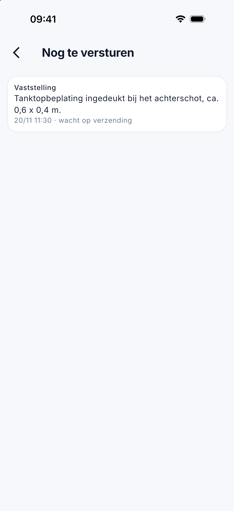

# Zonder bereik

Aan boord valt het bereik vaak weg: in een ruim, in een machinekamer, op een ankerplaats. De veldapp werkt dan verder. Wat u doet, bewaart ze eerst op het toestel. Zodra er weer bereik is, vertrekt het naar Quaymark.

## Wat u ziet zonder bereik

Bij elke synchronisatie haalt de app uw open dossiers volledig op. Zonder bereik ziet u de stand van de laatste keer, met bovenaan Mijn dossiers *Zonder bereik — laatst opgehaalde stand*.

Synchroniseer dus voor u aan boord gaat, terwijl u nog bereik hebt. → [Synchroniseren](mijn-dossiers.md#synchroniseren)

## Wat u kunt doen zonder bereik

Alles wat u aan boord vastlegt:

- [vaststellingen](vaststellingen.md) met foto's;
- de [checklist](checklist.md) beantwoorden;
- [laten tekenen](laten-tekenen.md);
- [spraaknotities, codes, documenten van boord en peilingen](aan-boord.md);
- [tijd registreren](tijd.md);
- het werk starten en afronden.

Na het bewaren zegt de app *Bewaard op het toestel — wordt verstuurd zodra er bereik is.* Op de kaart staat er een wolk bij, met *nog niet verstuurd*.

## Wanneer het vertrekt

De app verstuurt bij elke synchronisatie: wanneer Mijn dossiers opent, wanneer u terugkeert naar de app, en met **Synchroniseren**. Ze verstuurt in de volgorde waarin u werkte: eerst een vaststelling, dan haar foto's en de handtekening waarin ze staat. Een foto wordt in stukken verstuurd: valt het bereik halverwege weg, dan gaat de volgende keer verder waar het stopte.

Wat al verstuurd is, krijgt een vinkje.

## Nog te versturen

Wacht er iets, dan staat rechtsboven op Mijn dossiers **… wachtend**, en in het menu **Nog te versturen** met het aantal. Tik erop voor de lijst: per handeling wat het is en wanneer u het deed, met *wacht op verzending*. Staat er **Alles is verstuurd.**, dan heeft Quaymark alles.

{ width="320" }

### Een geweigerde handeling

Soms weigert Quaymark iets, bijvoorbeeld omdat het dossier intussen afgesloten werd. Bovenaan Mijn dossiers staat dan in het rood *… geweigerd — tik om na te kijken*. Op **Nog te versturen** staat de handeling in het rood, met **Geweigerd door de server** en de reden.

- **Opnieuw proberen**: verstuurt ze meteen nog eens. Zinvol als de oorzaak intussen weg is.
- **Weggooien**: de handeling vertrekt nooit. De app vraagt het eerst. Bij een vaststelling gaan haar foto's mee weg.

Een geweigerde handeling houdt de volgende van hetzelfde dossier tegen. Kijk ze dus meteen na.

Ook een **foto** kan geweigerd worden, bijvoorbeeld als ze op het toestel gewijzigd werd na de opname. Ze staat er met het begin van haar vingerafdruk en de reden, met dezelfde twee knoppen.

### Te oud om nog te versturen

Een handeling die meer dan 30 dagen wacht, vertrekt niet meer. Kijk na of het al op kantoor staat. Zo niet, doe het opnieuw en gooi de oude handeling weg.

### Onleesbare handeling

Een enkele keer is een handeling op het toestel beschadigd. Ze blijft in de lijst tot u ze weggooit. Laat kantoor weten wat u die dag deed, zodat zij het aanvullen.

## Afmelden met iets in de wachtrij

Meldt u zich af terwijl er nog iets wacht, dan zegt de app hoeveel. Het blijft op het toestel en vertrekt zodra u zich opnieuw aanmeldt. Een collega die zich op hetzelfde toestel aanmeldt, verstuurt het niet. → [Afmelden](aan-de-slag.md#afmelden)

## Veelgemaakte fouten

!!! warning "Een dossier opent niet zonder bereik"
    De app toont enkel wat ze ooit ophaalde. Werd het dossier toegewezen terwijl u al aan boord was, dan staat het nog niet op uw toestel. Synchroniseer zodra u bereik hebt.

!!! warning "Werk dat niet aankomt op kantoor"
    Kijk op **Nog te versturen**. Staat het er nog, dan wacht het op bereik, of werd het geweigerd. Staat er **Alles is verstuurd.**, dan heeft Quaymark het.

## Zie ook

- [Mijn dossiers](mijn-dossiers.md)
- [Het dossier](dossier.md)
