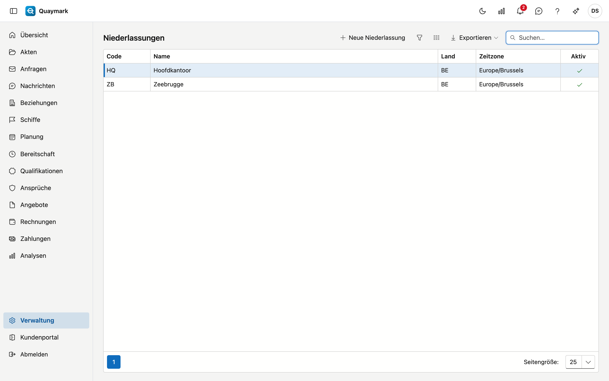

# Niederlassungen

Die Niederlassungen des Büros. Jede Akte gehört zu einer Niederlassung.

## Bildschirm öffnen

Klicken Sie unten im Menü auf **Verwaltung** und dann auf die Kachel **Niederlassungen**.

## Felder und Funktionen

- Der **Code** (2 bis 10 Buchstaben oder Ziffern) steht am Anfang jeder Aktennummer, zum Beispiel ANR-2026-0001. Die Nummerierung läuft pro Niederlassung und pro Jahr. Der Code steht fest, sobald es Akten für die Niederlassung gibt; im Fenster ist das Feld dann deaktiviert.
- Die **Zeitzone** bestimmt, in welcher Zeit eine geplante Besichtigung angezeigt und erfasst wird. Ein Büro in Dünkirchen plant in französischer Zeit, auch wenn die Akte in Antwerpen eingeplant wird.
- Doppelklicken Sie auf eine Zeile, um sie zu bearbeiten; **Neue Niederlassung** fügt eine hinzu. Eine Niederlassung, die nicht mehr verwendet wird, setzen Sie auf **inaktiv**: Sie ist dann für eine neue Akte, ein Angebot oder eine Rechnung nicht mehr wählbar. Die letzte aktive Niederlassung kann nicht deaktiviert werden.

## Siehe auch

- [Akten](dossiers.md)
