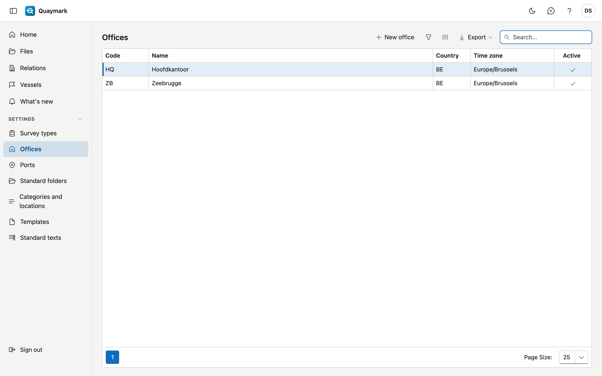

# Offices

The offices of the survey firm. Every file belongs to one office.

## Opening the screen

In the menu on the left, click **Settings**, then **Offices**.

## Fields and functions

- The **code** (2 to 10 letters or digits) starts every file number, for example ANR-2026-0001. Numbering runs per office and per year. The code is fixed once files exist for the office.
- The **time zone** determines in which time a scheduled survey is shown and entered. An office in Dunkirk plans in French time, even if the file is scheduled from Antwerp.
- Double-click a row to edit it; **New office** adds one. Set an office that is no longer used to **inactive**.

## See also

- [Files](dossiers.md)
