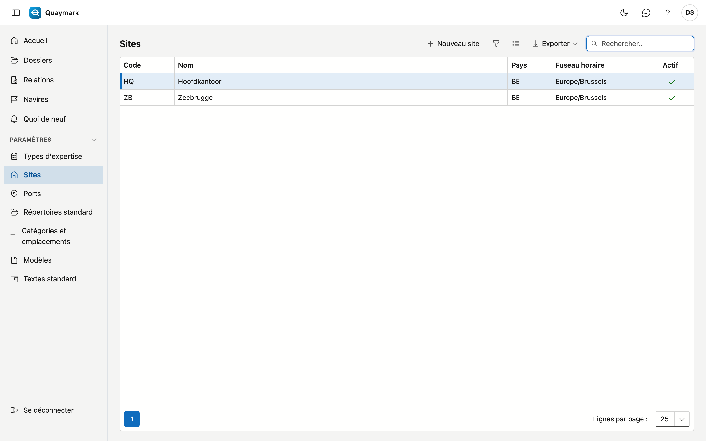

# Sites

Les bureaux du cabinet. Chaque dossier appartient à un site.

## Ouvrir l'écran

Dans le menu de gauche, cliquez sur **Paramètres** puis sur **Sites**.

## Champs et fonctions

- Le **code** (2 à 10 lettres ou chiffres) figure en tête de chaque numéro de dossier, par exemple ANR-2026-0001. La numérotation suit le site et l'année. Le code est fixé dès que des dossiers existent pour le site.
- Le **fuseau horaire** détermine dans quelle heure une expertise planifiée est affichée et saisie. Un bureau à Dunkerque planifie à l'heure française, même si le dossier est planifié à Anvers.
- Double-cliquez sur une ligne pour la modifier ; **Nouveau site** en ajoute un. Un site qui n'est plus utilisé passe en **non actif**.

## Voir aussi

- [Dossiers](dossiers.md)
