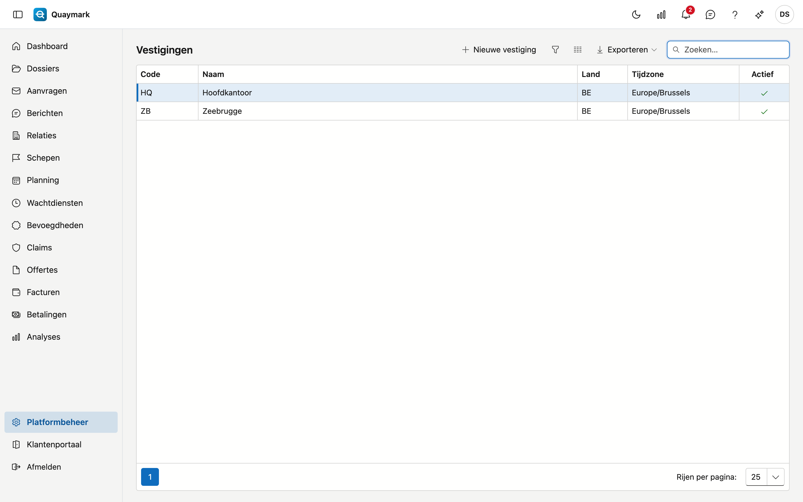

# Vestigingen

De kantoren van het bureau. Elk dossier hoort bij één vestiging.

## Het scherm openen

Klik onderaan het menu op **Platformbeheer** en dan op de tegel **Vestigingen**.

## Velden en functies

- De **code** (2 tot 10 letters of cijfers) staat vooraan in elk dossiernummer, bijvoorbeeld ANR-2026-0001. De nummering loopt per vestiging en per jaar. De code ligt vast zodra er dossiers op de vestiging staan; in het venster staat het veld dan uit.
- De **tijdzone** bepaalt in welke tijd een geplande survey getoond en ingevoerd wordt. Een kantoor in Duinkerke plant in Franse tijd, ook als het dossier in Antwerpen ingepland wordt.
- Dubbelklik op een rij om ze te bewerken; **Nieuwe vestiging** voegt er een toe. Een vestiging die niet meer gebruikt wordt, zet u op **niet actief**: ze is dan niet meer kiesbaar bij een nieuw dossier, een offerte of een factuur. De laatste actieve vestiging kan niet uit.

## Zie ook

- [Dossiers](dossiers.md)
