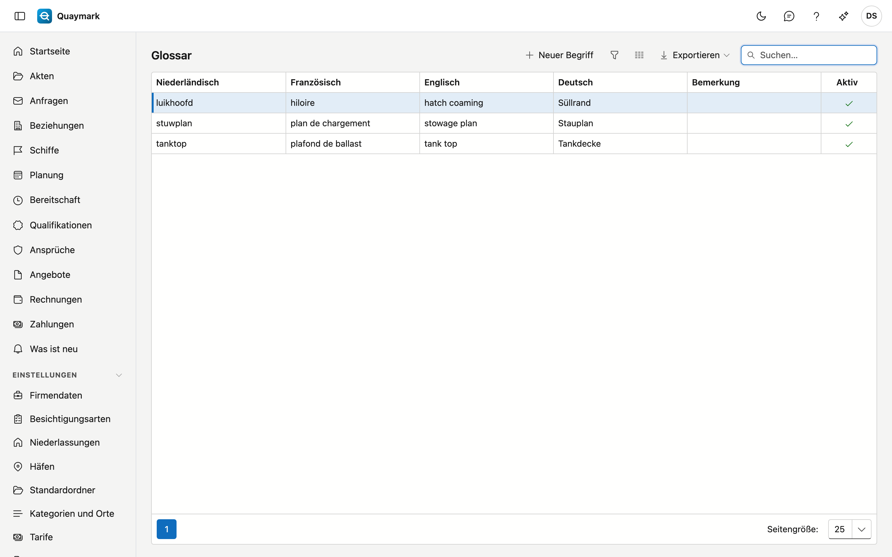

# Glossar

Die Fachbegriffe des Büros in den vier Sprachen, zum Beispiel *luikhoofd*, *hiloire*, *hatch coaming* und *Süllrand*. Übersetzen Sie einen Bericht, gelten sie als feste Übersetzung.

## Den Bildschirm öffnen

Klicken Sie im Menü links auf **Einstellungen** und dann auf **Glossar**.

## Felder und Funktionen

- Füllen Sie den Begriff in **mindestens zwei Sprachen** aus. Eine leere Sprache wird nicht verwendet: Der Begriff geht dann nicht in diese Sprache mit.
- **Bemerkung**: für Sie selbst, zum Beispiel wann der Begriff passt und wann nicht.
- Einen Begriff, den Sie nicht mehr wollen, setzen Sie auf **nicht aktiv**.

Beim Übersetzen gehen nur die Begriffe mit, die als ganzes Wort im Ausgangstext stehen, in der Ausgangssprache und der Zielsprache.

## Siehe auch

- [Akten](dossiers.md), die Registerkarte Bericht
- [Standardtexte](standaardteksten.md)
