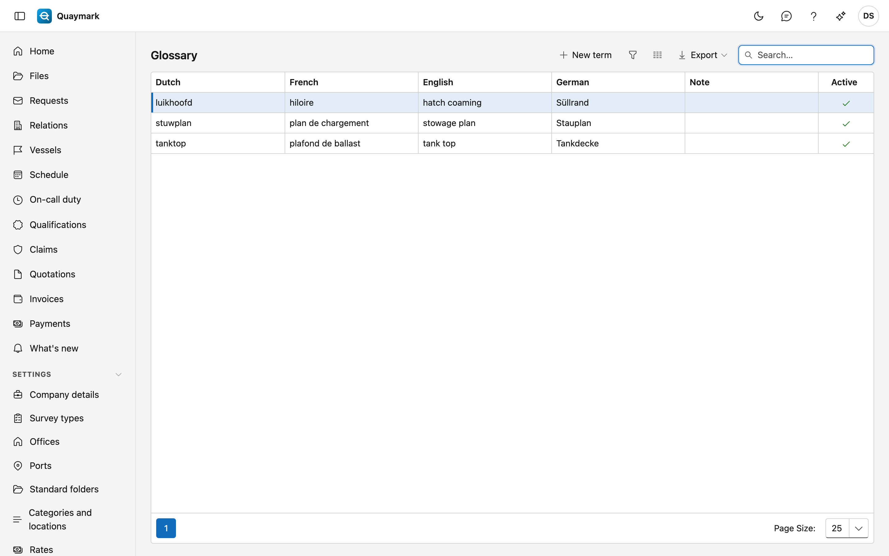

# Glossary

The office's technical terms in the four languages, for example *luikhoofd*, *hiloire*, *hatch coaming* and *Süllrand*. When you translate a report, they are used as fixed translations.

## Opening the screen

In the menu on the left, click **Settings** and then **Glossary**.

## Fields and functions

- Fill in the term in **at least two languages**. An empty language is not used: the term is then not passed on to that language.
- **Note**: for yourself, for example when the term does or does not fit.
- Set a term you no longer want to **inactive**.

When translating, only the terms that occur as a whole word in the source text are passed on, in the source language and the target language.

## See also

- [Files](dossiers.md), the Report tab
- [Standard texts](standaardteksten.md)
