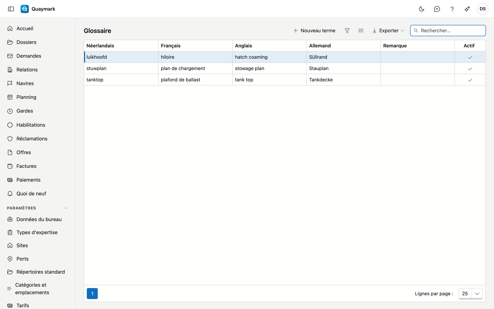

# Glossaire

Les termes techniques du bureau dans les quatre langues, par exemple *luikhoofd*, *hiloire*, *hatch coaming* et *Süllrand*. Lorsque vous traduisez un rapport, ils servent de traduction imposée.

## Ouvrir l'écran

Dans le menu de gauche, cliquez sur **Paramètres**, puis sur **Glossaire**.

## Champs et fonctions

- Remplissez le terme dans **au moins deux langues**. Une langue vide n'est pas utilisée : le terme n'est alors pas transmis vers cette langue.
- **Remarque** : pour vous-même, par exemple quand le terme convient ou non.
- Un terme dont vous ne voulez plus passe en **non actif**.

Lors d'une traduction, seuls les termes qui figurent comme mot entier dans le texte source sont transmis, dans la langue source et la langue cible.

## Voir aussi

- [Dossiers](dossiers.md), l'onglet Rapport
- [Textes standard](standaardteksten.md)
