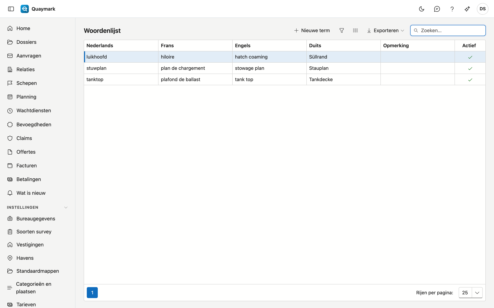

# Woordenlijst

De vaktermen van het bureau in de vier talen, bijvoorbeeld *luikhoofd*, *hiloire*, *hatch coaming* en *Süllrand*. Vertaalt u een rapport, dan gaan ze mee als vaste vertaling.

## Het scherm openen

Klik in het menu links op **Instellingen** en dan op **Woordenlijst**.

## Velden en functies

- Vul de term in **minstens twee talen** in. Een lege taal wordt niet gebruikt: de term gaat dan niet mee naar die taal.
- **Opmerking**: voor uzelf, bijvoorbeeld wanneer de term wel of niet past.
- Een term die u niet meer wil, zet u op **niet actief**.

Bij het vertalen gaan enkel de termen mee die als heel woord in de brontekst staan, in de taal van de brontekst en de doeltaal.

## Zie ook

- [Dossiers](dossiers.md), het tabblad Rapport
- [Standaardteksten](standaardteksten.md)
